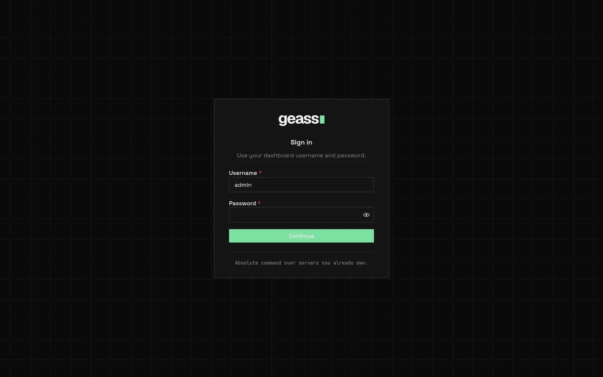

At the end of the install, the installer prints a setup link, for example:

```text
Open the dashboard
  Open this link in your browser, and create your admin user:
    https://203.0.113.10/setup#k7Qx…
  The link works once, for 24 hours.
```

The link opens the dashboard over HTTPS at the IP address of your server. You do not need a domain or SSH for it.

## Open the dashboard

1. Copy the link that the installer printed, and open it in your browser.
2. In **Username**, keep `admin`, or enter another name.
3. In **Password**, enter a password of at least 12 characters.
4. Click **Create admin**.

The dashboard signs you in. Save the password in your password manager. Geass keeps only a hash of it.

The link works once, for 24 hours. If the link expired, or someone used it, make a new one. See
[Lost the link or every password](#lost-the-link-or-every-password).

The dashboard stays at `https://<server IP>` until you [put it on a domain](#put-the-dashboard-on-a-domain). To sign in
again later, open that address, enter your username and password, and click **Continue**.


*Screenshot with example data.*

A session lasts 12 hours. Usernames do not depend on letter case.

After five failed attempts for one username from one address in one minute, Geass locks that username for that address.
The lock lasts one minute. The page still says `invalid username or password`. Wait one minute, and then try again. See
[Security](/docs/operations/security/#dashboard-users) for the full lockout rules.

### When the installer prints an SSH command

To serve the dashboard at its IP address, Let's Encrypt must reach your server on port 80. If it cannot, the installer
says why, and prints an SSH command and a `localhost` link instead:

1. On your computer, run the `ssh` command that the installer printed. Keep this terminal open.
2. In your browser, open the `http://localhost:8085/setup#…` link that the installer printed.
3. Create your admin as in the steps above.

The common reasons are these:

- A cloud firewall, for example an AWS security group, blocks port 80 or 443. Open both ports to the internet. Then make
  a new link. See [Lost the link or every password](#lost-the-link-or-every-password).
- The server has no public IPv4 address. Use the SSH command, or [put the dashboard on a domain](#put-the-dashboard-on-a-domain).

If you installed Geass on the computer that you use, skip step 1.

## Lost the link or every password

To get a new setup link, run this command on the first server:

```bash
curl -sfL https://github.com/degoke/geass/releases/latest/download/install.sh | sudo sh -s -- dashboard-link
```

The command prints a new link, which works once, for 24 hours. An earlier link that nobody used stops working. If you
enter the name of an existing user, the link sets a new password for that user, makes the user an admin, and signs out
the other sessions of that user.

If you lost only your own password, ask another admin to reset it under **Settings** → **Users**. See
[Users and API tokens](/docs/guides/users-and-tokens/#reset-a-password).

## Sign out and add people

To sign out, open the account menu at the top right, and select **Sign out**. Sign-out ends the sessions of that user in
every browser.

To invite people, let them sign in by email, or use organizations and teams, connect an identity provider. Open
**Settings** → **Sign-in**. See [Sign in with an identity provider](/docs/guides/external-sign-in/).

## Put the dashboard on a domain

Before you use the dashboard from other places, give it a domain:

1. Open **Settings** → **Domain**.
2. If **Certificate email** shows **Not set**, enter your email address, and click **Save email**. Let's Encrypt needs
   this address before it issues HTTPS certificates.
3. Enter your domain, and click **Save dashboard domain**.

From then on, open the dashboard at its domain, for example `https://geass.example.com`. For the DNS record and the
ports, see [Connect a domain](/docs/getting-started/connect-domain/).

## Sign in from the command line

The `geass` command line has no password. It signs in with a code that you approve in the dashboard. You need a
dashboard login first. To install the command line, see
[Install Geass](/docs/getting-started/install/#install-the-command-line-optional).

1. Run `geass login` with the address of your dashboard:

   ```bash
   geass login --url https://geass.example.com
   ```

   Before you have a domain, use the address of the dashboard at the IP address of your server, for example
   `--url https://203.0.113.10`.

2. The command prints a code, for example `BCDF-GHJK`, and opens the page `/device` of your dashboard in your browser. To
   stop the browser from opening, add `--no-browser`.
3. If the dashboard asks, sign in as an admin.
4. On the page **Sign in the command line**, make sure that the code is the code in your terminal. Approve only a code
   that you started.
5. Select an **Access** level: **Read only, including logs (recommended)**, **Read only, without logs**, or **Full
   access**.
6. Select an **Expires** period: **7 days**, **30 days**, or **90 days**. The default is **30 days**.
7. Click **Approve**.

The terminal then prints `Signed in to ... as token:CLI: geass CLI on <machine>`. The code is valid for 10 minutes. Only
an admin who signed in to the dashboard can approve a code. A viewer and an API token cannot.

The approval creates an API token named `CLI: geass CLI on <machine>` in **Settings** → **Tokens**. To end the token,
revoke it there. `geass logout` only removes the token from your computer. For scripts and CI, create a token under
**Settings** → **Tokens**, and set `GEASS_URL` and `GEASS_TOKEN`. See [Command line](/docs/guides/command-line/#sign-in)
and [Users and API tokens](/docs/guides/users-and-tokens/).

## Roles

Each user has one role.

| Role | What the user can do |
| --- | --- |
| `admin` | Everything in the dashboard: create, change, deploy, and delete, change settings, and create API tokens. |
| `viewer` | Read only. A viewer cannot see logs, terminals, variable values, API tokens, connection details, or hostnames. |

The user that the installer creates is an `admin`. A user without a `role` is a `viewer`. API tokens have one more
role, **Read only, with logs**. See [Users and API tokens](/docs/guides/users-and-tokens/).

## Troubleshooting

**The setup link does not open.** Port 443 is closed to your computer, or the server has a new IP address. Open ports
80 and 443, and then [make a new link](#lost-the-link-or-every-password).

**The page says `this setup link was used or has expired`.** [Make a new link](#lost-the-link-or-every-password).

**`localhost:8085` does not respond.** The SSH session closed, or the dashboard on the server stopped. Start the
`ssh` command again. If the page still does not respond, see [Under the hood](#under-the-hood).

**`invalid username or password`.** The username or the password is wrong, or the username is locked for one minute.
Wait one minute, and then try again.

**You sign in and return to the sign-in page.** The browser rejected the sign-in cookie. Open the dashboard at an
HTTPS address, or at `http://localhost:8085` with the SSH command.

**The installer printed no setup link.** The installer makes a link only when the dashboard has no users. Sign in with
an existing user, or [make a new link](#lost-the-link-or-every-password).

**`request origin could not be verified`.** A proxy or a tunnel changed the host name of the request. Forward the
original `Host` header, or open the dashboard as [Open the dashboard](#open-the-dashboard) shows.

**`dashboard authentication is unavailable` when you click Continue.** Geass found no valid user.
[Make a new link](#lost-the-link-or-every-password).

**The page says `Dashboard unavailable`.** Click **Try again**. If the message stays, read the Geass log. See
[Under the hood](#under-the-hood).

**`geass login` says `the sign-in was not approved in time`, or the page says `No sign-in request has that code`.** The
code expired after 10 minutes, or Geass restarted. Run `geass login` again.

**The approval page says `Only an admin can approve this`.** You signed in as a viewer. Sign in as an admin.

## Under the hood

### When the dashboard does not answer on the server

To see whether the dashboard service on the server runs, run this command on the server, and read its last lines:

```bash
sudo systemctl status geass-dashboard
```

On a server that uses OpenRC, run `sudo rc-service geass-dashboard status` instead.

### How the dashboard is reached

On a new cluster, the installer sets `spec.dashboard.publicIP: true` on the GeassCluster. Until the dashboard domain is
verified, the operator then keeps these objects:

- The ClusterIssuer `geass-letsencrypt-ip`. It uses the Let's Encrypt profile `shortlived`, which IP address
  certificates require, and it needs no email. The `letsencrypt-prod` issuer for domains does not change.
- The Certificate `geass-dashboard-public-ip` in `geass-system`, for the public IPv4 address of the server. It lasts about
  six days, and cert-manager renews it.
- The Traefik `TLSStore` named `default` in `geass-system`. A browser sends no server name for an IP address, so Traefik
  answers with this default certificate.
- The Traefik `IngressRoute` `geass-dashboard-public-ip`. It sends HTTPS requests for the address, and no other host, to
  the dashboard Service `geass-geass-dashboard` on port 8085.
- The Traefik `Middleware` and `IngressRoute` `geass-dashboard-public-ip-http`. They redirect plain HTTP for the address to
  HTTPS. Requests under `/.well-known/acme-challenge/` are not redirected, so that the certificate renews.

The GeassCluster condition `DashboardPublicIP` says how this goes, and `status.dashboardPublicURL` holds the address when
it answers. When the dashboard domain is verified, the operator deletes the four objects. If a `TLSStore` named `default`
that Geass did not create exists in `geass-system`, Geass leaves it, and the condition says `TLSStoreInUse`.

To read the condition, run this command:

```bash
sudo k3s kubectl -n geass-system get geasscluster default -o jsonpath='{.status.conditions[?(@.type=="DashboardPublicIP")].message}'
```

The installer also adds the service `geass-dashboard` on the first server: a systemd unit, or an OpenRC script. It runs
`k3s kubectl port-forward --address 127.0.0.1` to the dashboard Service, so the dashboard also answers on
`127.0.0.1:8085`. The SSH command uses this address. The installer adds this service on a new install only.

The users are in the Kubernetes Secret `geass-dashboard-auth` in the namespace `geass-system`. A setup link is the key
`setup` of that Secret: a SHA-256 hash of the token and the time when the link expires. The token follows the `#` of the
link, and a browser never sends that part to a server. A wrong token counts as a failed sign-in for the lockout. The
installer and `dashboard-link` write only the `setup` key, and never change users. You edit only the `users` key. Geass
manages the other keys: `session-key`, `session-epochs`, and `login-lockouts`.

To read the users, run this command. The output shows usernames, roles, and password hashes:

```bash
sudo k3s kubectl -n geass-system get secret geass-dashboard-auth -o jsonpath='{.data.users}' | base64 -d
```

### Set a new password

To add users, change roles, and reset passwords, use **Settings** → **Users**. See
[Users and API tokens](/docs/guides/users-and-tokens/#manage-users). When no admin can sign in, make a new setup link.
See [Lost the link or every password](#lost-the-link-or-every-password).

### Other details

Geass can also read users from the environment variables `GEASS_DASHBOARD_PASSWORD`, `GEASS_DASHBOARD_USERNAME`, and
`GEASS_DASHBOARD_USERS` on the `manager` container of the Deployment `geass-controller-manager`. Geass uses them only when
the Secret has no valid users. At the first sign-in, Geass copies them into the Secret, and from then on the Secret has
priority. `GEASS_DASHBOARD_SESSION_KEY` sets the session key and has priority over the Secret. Use the Secret instead,
because the variables show the password in plain text to anyone who can read the Deployment.

The session cookie is `__Host-geass_session`, or `geass_session` over plain HTTP on `localhost`. It is `HttpOnly`,
`SameSite=Lax`, and `Secure` except on a loopback address. Geass checks the `Origin` or `Referer` of each change against
the `Host` of the request. A reverse proxy in front of the dashboard must pass the `Host` header without a change.

If you run `kubectl` on your own computer against this cluster, you can run a `port-forward` command there instead of
the SSH command. K3s writes its kubeconfig to `/etc/rancher/k3s/k3s.yaml` on the server, with the address `127.0.0.1`.
Change that address to one that your computer can reach, and open 6443/tcp to your computer.

To read the Geass log, run this command on the server:

```bash
sudo k3s kubectl -n geass-system logs deploy/geass-controller-manager -c manager
```

## Related

- [Deploy your first app](/docs/getting-started/first-app/)
- [Connect a domain](/docs/getting-started/connect-domain/)
- [Command line](/docs/guides/command-line/)
- [Users and API tokens](/docs/guides/users-and-tokens/)
- [Security](/docs/operations/security/)
