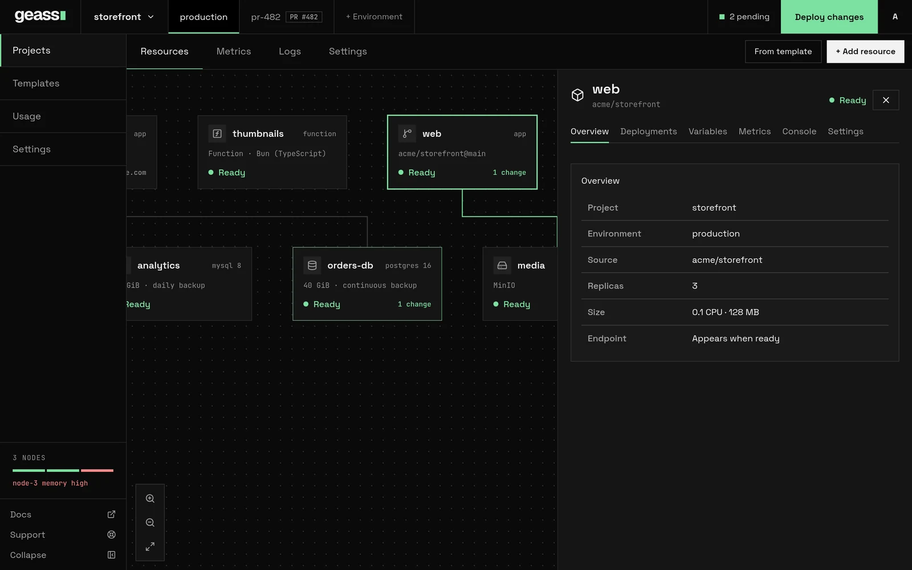

An **app** (the dashboard also calls it a **service**) is a container that Geass keeps running for you. You create it
from a container image or from a GitHub repository, give it a port and a size, optionally a public domain, and Geass
runs it as a Kubernetes Deployment behind a Service and, if you set a domain, an Ingress. If you want to run a small
piece of code without building an image, see [Functions](/docs/guides/functions/).


*Screenshot with example data.*

## Before you start

- A project and an environment to put the service in. See
  [Projects and environments](/docs/guides/projects-and-environments/).
- For a container image: the image reference, and your registry credentials if the image is private (see
  [Pull a private image](#pull-a-private-image)).
- For a GitHub repository: a connected GitHub App, a Dockerfile in the repository, and a container registry you
  control, because Geass builds the image and has to push it somewhere. See
  [GitHub and builds](/docs/guides/github-and-builds/).
- Free capacity in the cluster for the size you choose. See [Usage and capacity](/docs/guides/usage-and-capacity/).

## Create a service from a container image

1. Open the project, pick the environment tab, and choose **+ Add resource**.
2. Choose **Docker Image**, type the image reference (for example `ghcr.io/acme/storefront:1.4.0` or `nginx:alpine`),
   and press Enter or choose **Create**. You can also paste a reference that contains `/` or `:` straight into the first
   search box and choose the **Deploy image …** row.
3. Geass saves the service as a **draft** and opens its **Settings**. A draft runs nothing.
4. Set the **Port** under **Networking** to the port your container listens on. Add variables on the **Variables** tab.
   Add a domain if the service should be public.
5. Choose **Deploy changes** in the top bar. The status goes from **Draft** to **Setting up** to **Ready**.

An image reference may contain letters, digits and `. _ / @ : -`, must start with a letter or digit, and cannot contain
spaces. Docker Hub short names such as `nginx:alpine` work. Geass does not look the image up when you save it. A wrong
name shows up when you deploy, as a pod that cannot pull the image.

Pin a tag or a digest (`:1.4.0`, `@sha256:…`) rather than `latest`. Geass leaves Kubernetes's default pull policy in
place: a pod pulls `latest` every time it starts, but reuses an image that is already on the node for any other tag, so a
moving tag such as `:stable` can keep running an old image. A pinned tag also makes the
[deployment history](#deployments-redeploy-and-rollback) mean something.

## Create a service from a GitHub repository

1. Choose **+ Add resource** → **GitHub Repository**.
2. If the project is not linked to GitHub yet, choose **Connect GitHub** and follow GitHub's pages. If the cluster has no
   GitHub App yet, the box says so and links to **Settings** → **Connectors**.
3. Pick a repository from the list, or paste `acme/storefront` or a GitHub link into the first search box.
4. Geass saves a draft that follows the repository's default branch (the branch in a `/tree/` link, or `main` when you
   pasted a bare name), and opens its **Settings**. Check **Branch** and **Dockerfile path** under **Source** and **Build**.
5. Choose **Deploy changes**. Geass builds the image, pushes it to your registry, and runs it.

How the build works, where the image goes, what to do when it fails and how to build a newer commit is in
[GitHub and builds](/docs/guides/github-and-builds/). A push to the branch does not start a build today.

## The service panel

Click a service on the canvas to open its panel. The title is the **display name**: click it, type a new name and press
Enter (Escape cancels). The name is only a label. The **service ID**, such as `amber-fern`, is generated, never changes,
and is what you use in `kubectl` and in the private address.

The header shows the status and, when it applies, **Redeploy** or **Retry**. The tabs are:

| Tab | What it shows |
| --- | --- |
| **Overview** | Project, environment, source, replicas (with the autoscaling ceiling), size and endpoint. |
| **Deployments** | The live deployment and the history, with logs. |
| **Code** | Functions only: the code, its mode and its schedules. See [Functions](/docs/guides/functions/). |
| **Variables** | Variables, secrets, references and shared variables. See [Environment variables and secrets](/docs/guides/environment-variables/). |
| **Metrics** | Charts for the service. See [Observability](/docs/guides/observability/). |
| **Console** | A terminal inside a running pod. Admins only. See [Observability](/docs/guides/observability/). |
| **Settings** | Everything below. |

### Statuses

| Status | Meaning |
| --- | --- |
| **Draft** | The service was never deployed. Nothing runs. |
| **Setting up** | A deploy, a build or a rollout is in progress, or the pods are starting. A sleeping service that a request woke shows this until its copy is up. |
| **Ready** | The Deployment has all the replicas you asked for available. A service with 0 replicas counts as ready, and so does a service that is asleep because it [sleeps when idle](/docs/guides/scale-to-zero/). |
| **Unavailable** | Geass cannot proceed until something outside the service changes, such as free capacity or platform configuration, or a container is stuck (`CrashLoopBackOff`, `ImagePullBackOff` and similar). |
| **Failed** | The rollout failed, or provisioning failed after repeated errors. **Retry** appears when provisioning gave up. |
| **Deleting** | The service is being removed. |

## Settings

Open **Settings** on the service panel. It has a filter box at the top (press `/` to focus it) and a list of sections on
the right. Each section has its own **Save changes** button. After you save, a toast tells you what happened: "Saved.
Applied now", "Saved. Deploy to apply them", "Saved. Some changes are live; deploy to apply the rest", or "Nothing to
save".

Sections marked **Applies instantly** take effect on save even for a deployed service. Everything else becomes a pending
change until you choose **Deploy changes**. See
[Pending changes and Deploy changes](/docs/guides/projects-and-environments/#pending-changes-and-deploy-changes).

### Source

What the service runs. Only the block that matches how you created the service appears.

| Setting | Meaning | Default | Applies |
| --- | --- | --- | --- |
| **Image** | The container image reference. | What you entered. | On deploy |
| **Repository** | The GitHub repository, as `owner/name`. | The repository you picked. | On deploy |
| **Root directory** | Intended as the directory to build from. The build does not use it today; see [GitHub and builds](/docs/guides/github-and-builds/#choose-a-repository). | Empty | On deploy |
| **Branch** | The branch the build clones. A new commit on it is not built automatically today; see [Build a new commit](/docs/guides/github-and-builds/#build-a-new-commit). | The repository's default branch | On deploy |
| **Wait for CI** | Start a build only when the commit's GitHub checks have all succeeded. Needs the **Checks** permission on the GitHub App; see [Wait for CI](/docs/guides/github-and-builds/#wait-for-ci). | Off | On deploy |
| **Runtime** | Functions only: **Bun (TypeScript)**, **Node.js** or **Python**. The code, the mode and the schedules are on the **Code** tab. | **Bun (TypeScript)** | On deploy |

### Networking

| Setting | Meaning | Default | Applies |
| --- | --- | --- | --- |
| **Custom domain** | The hostname that reaches the service, such as `shop.example.com`. Enter the name only, without `https://`. Leave it empty for no public address. | None | Instantly |
| **Port** | The port the container listens on, 1 to 65535. | 8080 | On deploy |
| **HTTPS** | Serve the domain over TLS. Needs the `letsencrypt-prod` certificate issuer, which Geass creates when the cluster has an ACME email. See [Domains and TLS](/docs/guides/domains-and-tls/#https-and-certificates). | Off | Instantly |
| **Verify DNS** | Check that the hostname resolves each time Geass reconciles the service, and show the result under the URL. It never holds the service back from **Ready**, although the form text says "before reporting the domain as ready". | Off | Instantly |

Under the fields, **Public networking** shows the URL (with a link) once the service is ready, and a line such as
"Routed via <address>" or "Routed through the cluster ingress". When **Verify DNS** is on and the name did not resolve, the
line reads "DNS hostname is required", whatever the cause. **Private networking** shows the address other services in the
project can use, `<service ID>.<namespace>.svc.cluster.local:<port>`, with a copy button. It appears once the service has
been deployed.

How a domain reaches your service, how HTTPS works and how to fix DNS problems are in
[Domains and TLS](/docs/guides/domains-and-tls/).

**Ports and protocol.** A service has one port. The container port, the Kubernetes Service port and the Ingress
backend all use the **Port** value. There is no protocol setting: public traffic is HTTP or HTTPS through the cluster's
Traefik ingress. Other services in the project can connect to the port with any TCP protocol over the private address,
but Geass does not publish raw TCP to the internet. Make the process listen on all interfaces (`0.0.0.0`), not only on
`localhost`.

### Scale

| Setting | Meaning | Default | Applies |
| --- | --- | --- | --- |
| **Replicas** | How many copies run. The form takes 1 or more; the API accepts 0 to 1000. | 1 | Instantly |
| **CPU** and **Memory** | The size of each replica. | 0.1 CPU, 128 MB | On deploy |
| **Run on** | Only use nodes with the tags you tick. It appears only when nodes carry tags. See [Scaling and placement](/docs/guides/scaling-and-placement/). | None chosen | On deploy |
| **Enable autoscaling** | Add replicas when average CPU use goes above the target. | Off | Instantly |
| **Scale up to** | The most replicas autoscaling may run. | 3 | Instantly |
| **CPU target %** | The average CPU use that triggers scaling, 1 to 100. | 50 | Instantly |
| **Sleep when idle** | Stop the service when nobody is using it, and start it on the next request. It needs a public domain and the serverless add-on. Switching it on switches **Enable autoscaling** off, and the other way round. | Off | Instantly |
| **Sleep after (minutes)** | How long without a request before the service stops, 1 to 1440. | 5 | Instantly |

CPU sizes are 0.1, 0.25, 0.5, 1 and 2. Memory sizes are 128 MB, 256 MB, 512 MB, 1 GB, 2 GB and 4 GB. Geass sets both
the request and the limit to the size you choose, so a replica cannot burst above it and the capacity is reserved. A
replica that uses more memory than its limit is killed and restarted.

With autoscaling on, **Replicas** is the minimum. While a service sleeps when idle, **Replicas** does not apply: the scale-to-zero add-on decides how many copies run, from none up to 3 by default. If the service cannot sleep (no add-on, no public domain), the block says why and the service keeps running. See [Sleep when idle](/docs/guides/scale-to-zero/).

The deploy check compares the estimate (size times replicas, or times the autoscaling ceiling) with the free capacity of
the cluster. See [Usage and capacity](/docs/guides/usage-and-capacity/).

### Build

Only repository services have build settings. For a service that runs an image or a function, the section says there
is nothing to build. The **Builder** block says Geass builds with BuildKit. The build Job runs Kaniko.

| Setting | Meaning | Default | Applies |
| --- | --- | --- | --- |
| **Dockerfile path** | The Dockerfile to build, relative to the repository. | `Dockerfile` | On deploy |
| **Watch paths** | Gitignore-style rules, one per line, meant to limit which changes trigger a build. They are saved but not used today; see [GitHub and builds](/docs/guides/github-and-builds/#choose-a-repository). | Empty | Instantly |
| **Use build cache** | Reuse image layers between builds. It is part of the build's identity, so changing it starts a new build. | Off | On deploy |

### Deploy

| Setting | Meaning | Default | Applies |
| --- | --- | --- | --- |
| **Command** | Replaces the image's entrypoint. | The image default | On deploy |
| **Arguments** | Replaces the image's default arguments. | The image default | On deploy |
| **Working directory** | The directory the process starts in. | The image default | On deploy |
| **Path** (healthcheck) | An HTTP path Geass calls on the service port to decide the pod is ready. Empty means no check. | None | On deploy |
| **Policy** (restart) | Fixed at **Always**. The field is read-only. | Always | |
| **Enable metrics** | Expose Prometheus metrics from `/metrics` on the service port. Needs the Prometheus Operator, which the monitoring add-on installs. | Off | Instantly |

**Command and arguments.** Geass splits both fields on spaces and does not interpret quotes, so an argument that
contains a space cannot be written here. Set `spec.build.command` and `spec.build.args` in a manifest if you need that.

**Healthcheck.** The check is an HTTP GET on the service port with a 10 second period, a 2 second timeout and 3
failures allowed. While it fails, the pod receives no traffic and a rolling deploy waits. Choose a cheap path that
returns a status below 400 once the service can take requests. Without a check, a pod is ready as soon as its container
starts.

### General and Danger

**General** shows the project, the environment and the **Service ID** with a copy button. **Danger** deletes the service.
See [Delete a service](#delete-a-service).

### Settings only available through the API

The dashboard has no form for these. Send them to `POST /api/apps/{id}/update` or put them in a manifest.

| Field | Meaning |
| --- | --- |
| `livenessPath` and `livenessPort`, `readinessPort`, `readinessPeriod`, `readinessTimeout`, `readinessFailureThreshold` | A liveness probe, and the details of the readiness probe. A liveness failure restarts the container. |
| `minReplicas` | The autoscaling floor, when it should differ from `replicas`. |
| `scaleToZeroMax` | The most copies a service that sleeps when idle may run when awake, 1 to 100. The dashboard sets only `scaleToZero` and `idleSeconds`. |
| `functionMode`, `functionTriggers` | A function's mode and schedules. Also on the **Code** tab. See [Functions](/docs/guides/functions/). |
| `deploy=on` | Save and deploy in the same request. |
| `spec.ingress.rules` (manifest) | More than one host and path for the same service. |
| `spec.source.image.pullSecret` (manifest) | A registry pull secret. See [Pull a private image](#pull-a-private-image). |
| `spec.configMapRefs`, `spec.secretRefs` (manifest) | Mount existing ConfigMaps and Secrets of the environment's namespace. |
| `spec.build.registry` (manifest) | The registry a repository service builds into. See [GitHub and builds](/docs/guides/github-and-builds/#set-the-registry). |
| `spec.logs.archiveStoreRef` (manifest) | An object store that keeps the log of each build, which Geass otherwise deletes with the build Job an hour after it ends. |

:::note
The `spec.deploy` fields `failureThreshold`, `pauseOnFailure` and `rollbackOnFailure` exist in the resource. They only
pause reconciling or record a condition. Geass does not roll a failed deploy back for you.
:::

There is no persistent volume option for a service. The container filesystem is lost when a pod restarts, so keep state
in a [database](/docs/guides/databases/) or a [bucket](/docs/guides/object-storage/).

## Pull a private image

The dashboard has no field for registry credentials, so a private image needs a pull secret, set in the resource. Create
the secret in the environment's namespace, which exists once the project does, and name it in `pullSecret`:

```bash title="Give a service a pull secret"
kubectl -n proj-1a2b3c4d-production create secret docker-registry acme-registry \
  --docker-server=ghcr.io --docker-username=acme-bot --docker-password="$GHCR_TOKEN"

kubectl -n geass-system patch geassapp amber-fern --type merge \
  -p '{"spec":{"source":{"image":{"pullSecret":{"name":"acme-registry"}}}}}'
```

Then choose **Redeploy** on the service (or **Deploy changes** if it has pending changes), so Geass takes the new
setting into its deployed copy. The pull secret applies
to services that run an image. The image a repository build produces is pulled without one; see
[GitHub and builds](/docs/guides/github-and-builds/#set-the-registry).

## Deployments, redeploy and rollback

**Deployments** lists every deploy. The first card is the live one. **History (n)** below it lists earlier ones, newest
first, and **Hide skipped** removes skipped entries. Each row has a badge (**ACTIVE**, **FAILED**, **SKIPPED** or
**REMOVED** for an older deploy), a title such as `Deploy ghcr.io/acme/storefront:1.4.0` or `Deploy acme/storefront@main`,
and when it ran. Geass keeps the 12 most recent deployments of a service.

Choose **View logs**, or click a row, to open the log panel. It has four tabs:

- **Details**: the outcome, any errors, and the provisioning messages.
- **Build Logs**: for a repository service, only for a deployment that has a build attached. It shows the build's failure
  reason, or the build's name and phase. It does not show the Kaniko output; read that with `kubectl` (see
  [Build logs](/docs/guides/github-and-builds/#build-logs)).
- **Deploy Logs**: the last 400 lines of every running pod, for the active deployment only.
- **Network Logs**: not available yet. The tab says so.

**Redeploy** (in the header, when nothing is pending) restarts the pods with the saved settings. It does not rebuild a
repository service: the same image runs again. To build a newer commit, see
[Build a new commit](/docs/guides/github-and-builds/#build-a-new-commit).

**Rollback** has no button. The API, the command line (`geass rollback`) and an agent (`rollback_app`) can go back to an earlier deploy of a service that runs an image:

```bash title="Roll back an image service"
# List the recorded deployments of a service
kubectl -n geass-system get geassdeployments -l geass.dev/app=amber-fern

curl -X POST https://geass.example.com/api/apps/amber-fern/rollback \
  -H "Authorization: Bearer $GEASS_TOKEN" \
  -H "Accept: application/json" \
  -d revision=amber-fern-x7k2p
```

It sets the image back to the one recorded in that deployment, restores its replica count and redeploys. It does not
restore variables or other settings. For a repository service it only restores the replica count and redeploys the
current build, so to go back, revert the commit and then build it (see
[Build a new commit](/docs/guides/github-and-builds/#build-a-new-commit)). A function cannot be rolled back ("functions cannot be rolled
back; restore the earlier code and deploy again").

Other actions without a button are scaling (`POST /api/apps/{id}/scale` with `replicas`) and retrying a failed provision
(`POST /api/apps/{id}/retry-provision`). A project token can call them for the services of its environment. See
[Users and API tokens](/docs/guides/users-and-tokens/) and the [REST API](/docs/reference/rest-api/).

:::caution
`POST /api/apps/{id}/build` and `/build/cancel` do not act on the build Geass made for a repository service. They look
builds up by the label `geass.dev/app`, which that build does not carry. See
[Build a new commit](/docs/guides/github-and-builds/#build-a-new-commit).
:::

## From the command line or an agent

What you do in the dashboard is also a `geass` command and an MCP tool, and so are some things it has no button for. Both
use the same API as the dashboard, so drafts, pending changes and **Deploy changes** work the same way.

| To | Command | MCP tool |
| --- | --- | --- |
| Create a draft from an image, a repository or a function | `geass apps create web -p proj-1a2b3c4d -e production --image nginx:alpine --port 80` | `create_app` (image or repository) |
| Deploy the pending changes, and wait | `geass deploy web --wait` | `deploy_app` |
| Read a service's state and replicas | `geass status web` | `app_status` |
| Read its logs | `geass logs web` or `geass logs web -f` | `get_logs` |
| List its deployments | `geass apps deployments web` | `app_deployments` |
| Set a variable or a secret | `geass env set web LOG_LEVEL=debug` | `set_variable` |
| Set the replicas, or sleep when idle | `geass scale web 3`, `geass scale web --sleep-after 10m` | `scale_app`, `set_sleep_when_idle` |
| Go back to an earlier deploy | `geass rollback web` | `rollback_app` |
| Schedule a function | `geass functions triggers add report nightly "0 3 * * *"` | `set_function_trigger` |

See [Command line](/docs/guides/command-line/), [MCP server](/docs/guides/mcp-server/), the
[CLI reference](/docs/reference/cli/) and the [MCP tools](/docs/reference/mcp-tools/).

## Delete a service

1. Open the service, then **Settings** → **Danger** (the section is named **Delete service**).
2. Type the service **ID** (not the display name) in the box, choose **Delete service**, then **Delete permanently**.

You can also delete from the project's **Settings** → **Danger** → **Manage Services** → **Remove**.

Deleting removes the Deployment, Service, Ingress and autoscaler, a function's schedules, the service's variables and
secrets, its build records and its deployment history. It does not delete the image from your registry. Deletion is not reversible.

## Manifest and API

You can create a service without the dashboard by writing a `GeassApp`. A service created this way has no draft step: it
runs as soon as `spec.deploy.enabled` is `true`, and later edits apply directly, with no pending changes list.

```yaml title="storefront.yaml"
apiVersion: geass.geass.dev/v1alpha1
kind: GeassApp
metadata:
  name: amber-fern
  namespace: geass-system
  annotations:
    geass.dev/display-name: storefront
spec:
  project: proj-1a2b3c4d
  environment: production
  source:
    image:
      image: ghcr.io/acme/storefront:1.4.0
  port: 3000
  replicas: 2
  ingress:
    host: shop.example.com
    tlsEnabled: true
  resources:
    requests: { cpu: 250m, memory: 256Mi }
    limits: { cpu: 250m, memory: 256Mi }
  deploy:
    enabled: true
    readinessProbe:
      httpGet: { path: /healthz, port: 3000 }
  env:
    - name: LOG_LEVEL
      value: info
```

```bash
kubectl apply -f storefront.yaml
kubectl -n geass-system get geassapp amber-fern
```

`spec.project` is the project's ID, not its name: `kubectl -n geass-system get geassprojects` lists them. Without
`spec.deploy.enabled: true` the service stays a draft that the controller reports as "Service is configured and waiting
for deployment".

:::caution
Edit a service you created this way with `kubectl`. The dashboard's settings forms compare against a copy of the last
dashboard deploy, which a manifest does not create. If you want to edit such a service in the dashboard, choose
**Redeploy** on it first: that records the deployed copy.
:::

Through the API, `POST /api/apps/create` with `project`, `environment` and `image` (or `source=git` with `repository`
and `branch`, or `source=function` with `runtime`) creates a draft and answers with its ID in `name`. Without `name`, the ID comes from the image or
repository name (`storefront` for `ghcr.io/acme/storefront:1.4.0`). Add `draft=on` to get a generated ID like the
dashboard does. You deploy it with `POST /api/apps/{id}/deploy`. Both calls take a form body and need a workspace admin
token. The versioned API takes the same fields as JSON (`POST /api/v1/apps`, `PATCH /api/v1/apps/{name}` and
`POST /api/v1/apps/{name}/deploy`). See the [REST API](/docs/reference/rest-api/).

## What happens under the hood

For a service `amber-fern` in project `proj-1a2b3c4d`, environment `production`:

| Object | Namespace | Name |
| --- | --- | --- |
| `GeassApp`, the desired state | `geass-system` | `amber-fern` |
| `GeassDeployment`, one per deploy, plus `amber-fern-active` | `geass-system` | `amber-fern-<suffix>` |
| `GeassBuild` and its Job, repository services only | `geass-system` | `amber-fern-build-<hash>`, `…-kaniko` |
| Secret with the service's secret values | `geass-system` | `amber-fern-secrets` |
| Deployment, one container named `app` | `proj-1a2b3c4d-production` | `amber-fern` |
| Service on port `http` | `proj-1a2b3c4d-production` | `amber-fern` |
| Ingress, when a domain is set | `proj-1a2b3c4d-production` | `amber-fern` |
| ConfigMap and Secret holding variables | `proj-1a2b3c4d-production` | `amber-fern-config`, `amber-fern-secret` |
| HorizontalPodAutoscaler, when autoscaling is on | `proj-1a2b3c4d-production` | `amber-fern` |
| ServiceMonitor, when metrics are on | `proj-1a2b3c4d-production` | `amber-fern-metrics` |
| Service and HTTPScaledObject, when the service sleeps when idle | `proj-1a2b3c4d-production` | `amber-fern-wake`, `amber-fern` |
| CronJob per schedule, and Secret with its token, for a function | `proj-1a2b3c4d-production` | `amber-fern-<schedule>-<hash>`, `amber-fern-trigger` |

```bash title="Inspect a service"
kubectl -n geass-system get geassapp amber-fern -o yaml
kubectl -n proj-1a2b3c4d-production get deploy,pods,svc,ingress -l app.kubernetes.io/name=amber-fern
kubectl -n proj-1a2b3c4d-production describe deploy amber-fern
kubectl -n proj-1a2b3c4d-production logs -l app.kubernetes.io/name=amber-fern -c app --tail=100
```

The status of the `Ready` condition on the `GeassApp` carries the message the dashboard summarizes. A service
that fails repeatedly (five consecutive errors or three minutes) is marked `ProvisionFailed` and stops retrying until you
choose **Retry** or save a change. See [GeassApp](/docs/reference/resources/geass-app/#conditions) for every message.

## Troubleshooting

**The service stays a Draft after I saved.** Saving does not deploy a draft. Choose **Deploy changes** in the top bar.

**It stays in Setting up.** Open **Deployments** → **View logs**. For a repository service the message is "Git source
is waiting for a successful build": see [GitHub and builds](/docs/guides/github-and-builds/#troubleshooting). Otherwise run `kubectl -n <namespace> get pods` and
`describe` the pod. A pod that is `Pending` usually has nowhere to run; see [Usage and capacity](/docs/guides/usage-and-capacity/).

**The status is Unavailable and the condition says `The service cannot start: app is ImagePullBackOff`.** The same message
appears for `ErrImagePull`, `InvalidImageName`, `CrashLoopBackOff`, `CreateContainerConfigError` and
`CreateContainerError`. Geass reads it from the pod. If the container keeps failing, the status becomes **Failed** after
five failed checks or three minutes, and **Retry** appears. See [GeassApp](/docs/reference/resources/geass-app/#troubleshooting).

**Pods show `ErrImagePull` or `ImagePullBackOff`.** The image name or tag is wrong, or the image is private. Check the
name in **Source**. For a private image, set a [pull secret](#pull-a-private-image).

**Pods show `CrashLoopBackOff`.** The process exits. Read **Deploy Logs** or `kubectl logs --previous`. Common causes
are a missing variable (see the **Variables** tab and remember variables only apply after a deploy), a wrong
**Command**, or a process that listens on a different port than **Port**.

**The pod runs but the domain returns `502`, `503` or "no available server".** Either **Port** does not match the port
the process listens on, the process listens only on `localhost`, or the healthcheck fails so the pod receives no
traffic. Check `kubectl -n <namespace> get endpoints amber-fern`: an empty list means no ready pod.

**The domain returns `404 page not found`.** Traefik has no route for the hostname. The service may not be deployed
yet (the Ingress is created on deploy), the **Custom domain** may contain more than the hostname, or the request
reached a different server than the one running Geass. See [Domains and TLS](/docs/guides/domains-and-tls/).

**Deploy changes fails with "This service needs about … CPU and … memory".** The cluster does not have that much free.
Choose a smaller size, lower the replica count or autoscaling ceiling, or add a node.

**The status says "Provisioning failed after repeated errors" and shows Retry.** Geass gave up after repeated errors.
Read the error in **Deployments** → **View logs** → **Details**, fix the cause, then choose **Retry**.

**Enabling metrics fails with "metrics are enabled but Prometheus Operator is not installed in this cluster".** The
cluster has no `ServiceMonitor` kind. Turn on the monitoring add-on or turn metrics off.

**A variable I added is not in the container.** Variable changes wait for a deploy. See
[Environment variables and secrets](/docs/guides/environment-variables/).

**My change to Replicas or the domain took effect but the rest did not.** Replicas, autoscaling, sleep when idle, the
domain, HTTPS, DNS check, metrics and watch paths apply instantly. The rest waits for **Deploy changes**.

**The service has no pods and the status is Ready.** It is asleep: **Sleep when idle** is on and nobody has asked for it
for the idle time. The next request to its public domain starts it. See
[Sleep when idle](/docs/guides/scale-to-zero/).

## Related

- [Projects and environments](/docs/guides/projects-and-environments/)
- [Environment variables and secrets](/docs/guides/environment-variables/)
- [GitHub and builds](/docs/guides/github-and-builds/)
- [Domains and TLS](/docs/guides/domains-and-tls/)
- [Functions](/docs/guides/functions/)
- [Sleep when idle](/docs/guides/scale-to-zero/)
- [Command line](/docs/guides/command-line/) and [MCP server](/docs/guides/mcp-server/)
- [Scaling and placement](/docs/guides/scaling-and-placement/)
- [Observability](/docs/guides/observability/)
