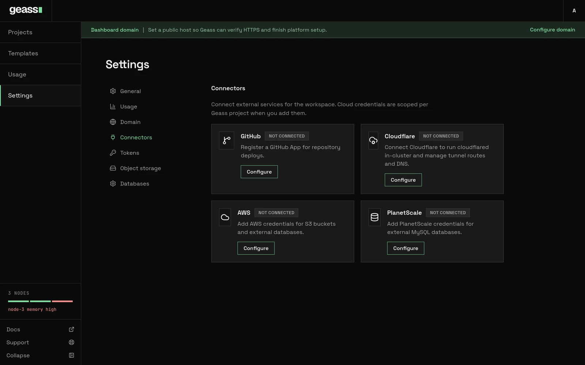

A connection holds the credentials that Geass uses to call another service for you. You manage connections in
**Settings** → **Connectors**. Only admins can add, change, or remove a connection.

**Settings** → **Connectors** has three parts:

- **Code and domains**: [**GitHub**](/docs/guides/connectors/github/) for repository deploys, and
  [**Cloudflare**](/docs/guides/connectors/cloudflare/) for DNS and an optional tunnel for the dashboard. These
  connections belong to the whole platform. The button on a card shows **Configure** until you set up the
  connection. After that, the button shows **Manage**.
- **Server clouds**: [connections for machines](/docs/guides/connectors/clouds/). With these connections, Geass can
  create and delete servers at 11 clouds, or through a webhook of your own. These connections belong to the whole
  cluster. This feature is experimental. To add a connection, click **Connect a cloud**.
- **Storage and databases**: [**AWS**](/docs/guides/connectors/aws/) for S3 buckets and database backups, and
  [**PlanetScale**](/docs/guides/connectors/planetscale/) for a managed database. Each of these connections belongs
  to one project, or to one organization.

The link between a project and GitHub is separate. It is in the project, under **Settings** → **GitHub**.


*Screenshot with example data, from before the cards were grouped under Code and domains and Storage and databases.*

:::caution
The AWS and PlanetScale connections are the least polished part of Geass. When you save one of these connections,
Geass does not check the credentials with the cloud. The first bucket, backup, or database that uses the connection
is the real test.
:::

## The connectors

| Connector | Used for | Belongs to | Credentials |
| --- | --- | --- | --- |
| [Clouds for machines](/docs/guides/connectors/clouds/) | Creating and deleting servers for [pools](/docs/guides/node-pools/) and single servers | The whole cluster, never a project | The credentials of each cloud: an API token, a pair of keys, or a service account |
| [AWS](/docs/guides/connectors/aws/) | S3 buckets and project database backups | One project, or one organization | Access key ID, secret access key, and region |
| [PlanetScale](/docs/guides/connectors/planetscale/) | Creating a database and a login on it | One project, or one organization | Service token and organization |
| [Cloudflare](/docs/guides/connectors/cloudflare/) | Dashboard DNS, an optional tunnel, and default hostnames | The whole cluster | API token, account, and zone |
| [GitHub](/docs/guides/connectors/github/) | Repository deploys, pull request environments, and reports back to GitHub | The cluster, linked to each project | GitHub App credentials |

Geass never shows a stored credential again, and the dashboard never sends one to the browser. To replace a
credential, enter it again.

A viewer or an observer token can read the list of connections. For each connection, the list shows the name, the
cloud, the purposes, whether the connection works, and what uses it. The list never shows the credentials, the cloud
account, or what the cloud said about the connection. A project token cannot read connections. For more information,
see [Users and API tokens](/docs/guides/users-and-tokens/).

Read [Security](/docs/operations/security/) before you give Geass a broad cloud key.

## Remove a connection

To remove an AWS, PlanetScale, or server cloud connection, click **Remove** on the connection. An AWS connection and a
server cloud connection also have **Edit**.

**Remove** refuses while something still uses the connection. **Remove** names each item that uses it, so that you can
delete or move that item first. These items can use a connection:

- A pool or a machine.
- A bucket or a database.
- The backups of a database that is gone.
- The backup bucket of a project.
- The control plane firewall.

For AWS, see [Remove an AWS connection](/docs/guides/connectors/aws/#remove-an-aws-connection).

## Servers and machines

You can add a server to the cluster in two ways. Only one of them needs a connection:

- **A server that you have.** Geass connects to the server over SSH, sets it up, and joins it to the cluster. This
  way needs no connection. See [Add servers](/docs/getting-started/add-servers/).
- **A machine that Geass creates.** With a [connection for machines](/docs/guides/connectors/clouds/), Geass creates
  a server at a cloud, and joins it in the same way. When the server is no longer wanted, Geass deletes it. To add
  one server, click **Add server** on the **Usage** page, or run `geass servers add`. To let Geass add and remove
  machines as the load changes, use a [pool](/docs/guides/node-pools/).

Machine creation is **experimental**. The Amazon EC2 driver has run against a live account. The other drivers were
tested only against a simulation. See [How far to trust it](/docs/guides/connectors/clouds/#how-far-to-trust-it).

A connection for machines is different from the other connections in four ways:

- It belongs to the cluster, and never to a project.
- Only an admin can use it.
- Geass checks it with the cloud when you save it, and again every 15 minutes.
- The cloud bills its account for every machine that Geass creates. Give the connection an account or a project of
  its own at the cloud.

A cluster with servers at more than one provider is also experimental. See
[Multi-provider clusters](/docs/operations/multi-provider/).

:::caution
Pin the host key of a server that you bring, or join only servers whose network path you trust. Without a pinned key,
Geass does not verify the identity of the server when it connects over SSH. See
[Add servers](/docs/getting-started/add-servers/#pin-the-servers-host-key-recommended). Geass makes the host key of a
machine that it creates, and checks that key.
:::

## Troubleshooting

This section covers the problems of every AWS and PlanetScale connection. Each connector page has its own
troubleshooting: [AWS](/docs/guides/connectors/aws/#troubleshooting),
[PlanetScale](/docs/guides/connectors/planetscale/#troubleshooting),
[Cloudflare](/docs/guides/connectors/cloudflare/#troubleshooting),
[GitHub](/docs/guides/connectors/github/#troubleshooting), and
[clouds for machines](/docs/guides/connectors/clouds/#troubleshooting).

**The connection stays Pending.** A credential is missing. The message says which: "AWS access key and secret key are
required" or "PlanetScale token and organization are required". For AWS, click **Edit**, and enter the credential
again. For PlanetScale, see [Rotate and remove](/docs/guides/connectors/planetscale/#rotate-and-remove).

**"project was not found" when you save a connection with the API.** You sent the display name of the project. Send
the project ID: `proj-` followed by eight characters. The ID is in the address of the project.

**"connection already exists".** A connection with that name exists, or an earlier failed save left its credentials
behind. Use another name.

**"cloud connection X is scoped to project Y".** A bucket or a database in one project named a connection that belongs
to another project. Add a connection for the project of the bucket or database.

## Under the hood

- AWS, PlanetScale, and server cloud connections are `GeassCloudConnection` resources in `geass-system`. Their
  credentials are in the Secret `<name>-credentials`. See
  [GeassCloudConnection](/docs/reference/resources/geass-cloud-connection/).
- Cloudflare and GitHub are on the platform configuration, named `platform`. Their credentials are in the Secrets
  `platform-cloudflare` and `platform-github-app`.
- On a cluster that the installer built, Secrets are encrypted at rest. Anyone who can read Secrets in `geass-system`
  can still read the credentials.

```bash title="Inspect connections"
kubectl -n geass-system get geasscloudconnections
kubectl -n geass-system get geassplatformconfig platform -o yaml
```

## Related

- [Cloud connections for machines](/docs/guides/connectors/clouds/)
- [Node pools and autoscaling](/docs/guides/node-pools/)
- [Connect AWS](/docs/guides/connectors/aws/)
- [Connect PlanetScale](/docs/guides/connectors/planetscale/)
- [Connect Cloudflare](/docs/guides/connectors/cloudflare/)
- [Connect GitHub](/docs/guides/connectors/github/)
- [Object storage](/docs/guides/object-storage/)
- [Backups and restore](/docs/guides/backups-and-restore/)
- [Users and API tokens](/docs/guides/users-and-tokens/)
- [Security](/docs/operations/security/)
