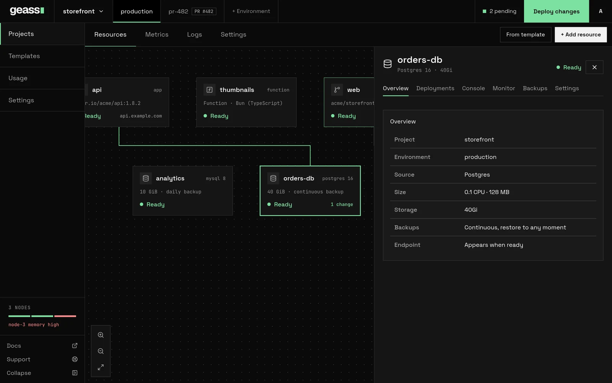

A database in Geass is a resource that belongs to one project environment. Geass runs it on your servers, creates its login, and publishes a connection string that your apps read from a Secret. You can run PostgreSQL, MySQL, MariaDB, Redis or SQLite in the cluster, connect an app to a database you already host elsewhere, such as AWS RDS, or have Geass create a database in your PlanetScale organization.


*Screenshot with example data.*

This page covers one database per resource. To share a single server between many projects, see [Shared database servers](/docs/guides/shared-database-servers/). For backups, see [Backups and restore](/docs/guides/backups-and-restore/). For how disks work, see [Storage and volumes](/docs/guides/storage/). To keep a project's data on nodes you choose, see [Where a database runs](#where-a-database-runs). To list databases and read how to connect from a terminal or an AI agent, see [Command line and AI agents](#command-line-and-ai-agents).

## Before you start

- You need a project and an environment. See [Projects and environments](/docs/guides/projects-and-environments/).
- The cluster needs room for the database. Deploying is refused when no node can fit it. If the project requires node tags, the room has to be on nodes that carry them. See [Where a database runs](#where-a-database-runs).
- The first PostgreSQL database on a cluster installs the CloudNativePG operator, which takes a few minutes. The first MariaDB database installs the MariaDB operator the same way, and the first highly available MySQL database installs MOCO.
- For backups, the project needs an AWS connection. To have Geass create a PlanetScale database, it needs a PlanetScale connection. Connecting to an external database you already host needs no connection. See [Cloud connectors](/docs/guides/connectors/).
- For resizable disks, the cluster needs the Longhorn add-on. See [Storage and volumes](/docs/guides/storage/).

## Engines

| Engine | What runs | Default size per instance | Disk | Backups |
| --- | --- | --- | --- | --- |
| PostgreSQL | A CloudNativePG cluster using the image `ghcr.io/cloudnative-pg/postgresql:<version>`. Version 16 by default | 0.25 CPU, 512 MB | 10 GiB | Continuous, restore to any moment |
| MySQL | The official `mysql:8.4.11` image, one pod on a volume. With high availability, three or five servers run by MOCO, from its own build of MySQL 8.4 | 0.25 CPU, 512 MB (1 GB with high availability) | 10 GiB | Daily copy |
| MariaDB | The official `mariadb:11.8.9` image, run by the MariaDB operator: one server on a volume, or with high availability three or five that replicate to each other | 0.25 CPU, 512 MB | 10 GiB | One server: daily copy. With high availability: continuous, restore to any moment |
| Redis | The official `redis:7.4.11-alpine` image, one pod, with persistence off | 0.25 CPU, 512 MB | None | None |
| SQLite | rqlite 8.36.16, which serves SQLite over HTTP on port 4001 | 0.1 CPU, 128 MB | 1 GiB | Daily copy |

Things to know about each engine:

- **PostgreSQL** is the only engine that uses the **Version** field, although the dashboard shows the field for every database. It is the tag of the Postgres image, with no checking, so use a tag that exists. Geass does not migrate data between major versions. Choose the version before the first deploy.
- **MySQL and Redis** versions come from the images Geass pins (MySQL 8.4, Redis 7.4). The **Version** field has no effect on them. MySQL can be made highly available and Redis cannot: see [Instances and high availability](#instances-and-high-availability).
- **MariaDB** is a separate engine from MySQL, for software that asks for MariaDB or uses what only MariaDB has. Pick it when you create the database: an engine cannot change afterwards. The **Version** field has no effect on it. It is MariaDB 11.8 and speaks the MySQL protocol, so a MySQL client or driver connects to it, and the connection string starts `mysql://`. It can be made highly available: see [High availability for MariaDB](#high-availability-for-mariadb).
- **Redis** keeps its data in memory. It has no disk, no size setting and no backups. A restart empties it, so use it as a cache.
- **SQLite** runs as rqlite, one instance on one volume. Apps talk to it over HTTP at port 4001, not by opening a file. It has no login: the connection string is a plain `http://` address.
- **CPU and memory** are one setting. The limit equals the request, so a database never bursts beyond what it reserved. Choose CPU from 0.1, 0.25, 0.5, 1 or 2, and memory from 128 MB, 256 MB, 512 MB, 1 GB, 2 GB or 4 GB.

:::note
The dashboard shows every database with a version beside its engine, so a MySQL, MariaDB, Redis or SQLite database appears as `mysql 16` on its card and "MySQL 16" in its panel. The API and the command line report the same `version`. The number is the default of `spec.version`, which is `16` for every engine, and is not the engine's version.
:::

## Create a database

1. Open the project and environment. Select **+ Add resource**, then **Database**.
2. Choose **PostgreSQL**, **MySQL**, **Redis** or **SQLite**. Geass saves a draft and opens its **Settings**. The dashboard says "Database saved as a draft. Configure it in settings, then deploy."
3. In **Database**, set the **Version** (only PostgreSQL uses it), **CPU** and **Memory** under **Resources**, and the **Size** under **Storage**. In **Backups**, review the defaults. In **Scale**, choose **Run on** if your nodes have tags. A database keeps its data on the nodes it is first deployed to, so this choice closes at the first deploy. If the project requires compliance tags, you do not choose them here: Geass adds them. See [Scaling and placement](/docs/guides/scaling-and-placement/) and [Where a database runs](#where-a-database-runs).
4. Select **Save changes**. Every **Save changes** button on the page saves all values on it.
5. Select **Deploy changes** in the project's top bar. The **N pending** button beside it lists what will be deployed.

The status moves from **Draft** to **Setting up** and then **Ready**. **Unavailable** or **Failed** means something stopped it: see [Troubleshooting](#troubleshooting). The **Deployments** tab shows each attempt and its errors.

A new database starts with these values:

| Setting | Default |
| --- | --- |
| Name | A generated two-word resource ID such as `falling-mist` |
| Database name | The resource ID. For PostgreSQL and MySQL this is the database inside the server |
| Login | `app` |
| CPU and memory | 0.25 CPU and 512 MB (SQLite: 0.1 CPU and 128 MB) |
| Disk | 10 GiB (SQLite: 1 GiB, Redis: none) |
| Backups | On for PostgreSQL, MySQL and SQLite, kept 7 days. They protect nothing until the project has backup storage |
| Instances | 1 |

You can rename the database by editing its title. That changes the display name only. The resource ID, which you use in `kubectl` and the API, does not change.

### Create a database with the REST API

Use a workspace token with the admin role. Project tokens cannot create resources. See [Users and tokens](/docs/guides/users-and-tokens/) and the [REST API reference](/docs/reference/rest-api/). The request creates a draft, so deploy it afterwards.

```bash
curl -X POST https://geass.example.com/api/databases/create \
  -H "Authorization: Bearer $GEASS_TOKEN" \
  -H "Accept: application/json" \
  --data-urlencode project=proj-1a2b3c4d \
  --data-urlencode environment=production \
  --data-urlencode name=orders \
  --data-urlencode engine=Postgres \
  --data-urlencode storageSize=20Gi \
  --data-urlencode cpu=500m \
  --data-urlencode memory=1Gi

curl -X POST https://geass.example.com/api/databases/orders/deploy \
  -H "Authorization: Bearer $GEASS_TOKEN" \
  -H "Accept: application/json"
```

Find the project's ID in the address of its pages (`/projects/proj-1a2b3c4d`). The first reply is `{"ok":true,"name":"orders","kind":"databases"}`.

The versioned API does the same with JSON bodies: `POST /api/v1/databases`, `PATCH /api/v1/databases/{name}`, `POST /api/v1/databases/{name}/deploy` and `DELETE /api/v1/databases/{name}`. From a terminal, `geass api` calls them:

```bash
geass api POST /databases -d '{"project": "proj-1a2b3c4d", "environment": "production", "name": "orders", "engine": "Postgres", "storageSize": "20Gi"}'
geass api POST /databases/orders/deploy
```

The fields are the ones in [Options](#options). See the [REST API reference](/docs/reference/rest-api/#databases-logical-databases-and-buckets) and the [command line](/docs/guides/command-line/#anything-else-the-raw-api).

The resource ID (`name`) must be unique in the cluster, because every database is an object in `geass-system`. Leave `name` out and Geass generates a two-word ID and returns it. `cpu` and `memory` take the sizes the dashboard offers: `100m`, `250m`, `500m`, `1` or `2`, and `128Mi`, `256Mi`, `512Mi`, `1Gi`, `2Gi` or `4Gi`. Send both: if you send only one, the other falls back to `100m` or `128Mi`, not to the engine's default. A PostgreSQL, MySQL or SQLite database created this way starts with backups on and a 7-day retention whatever you send. Change that with `backups` and `backupRetentionDays` on `POST /api/databases/<ID>/update`, as described in [Backups and restore](/docs/guides/backups-and-restore/#turn-backups-on-off-or-change-retention).

### Create a database with a manifest

You can also apply a `GeassDatabase` in the `geass-system` namespace. An object created this way has no draft step and starts provisioning at once. Backups stay off unless you set `spec.backup`. Set `spec.deploy.enabled` to `true` as well. Without it the command line, the MCP server and the API list the database as `draft` even while it runs, and the dashboard still offers settings that close at the first deploy, such as **Run on**.

```yaml title="orders-db.yaml"
apiVersion: geass.geass.dev/v1alpha1
kind: GeassDatabase
metadata:
  name: orders
  namespace: geass-system
spec:
  project: proj-1a2b3c4d
  environment: production
  engine: Postgres
  version: "16"
  storageSize: 20Gi
  resources:
    requests:
      cpu: 500m
      memory: 1Gi
    limits:
      cpu: 500m
      memory: 1Gi
  backup:
    enabled: true
    retentionDays: 14
  deploy:
    enabled: true
```

```bash
kubectl apply -f orders-db.yaml
kubectl get geassdatabases -n geass-system
```

## Connect an app to a database

When a database is ready, Geass writes a Secret named `<resource ID>-connection` in the environment's namespace (`<project ID>-<environment>`).

| Key | Value |
| --- | --- |
| `host` | The in-cluster address of the database |
| `port` | `5432` PostgreSQL, `3306` MySQL, `6379` Redis, `4001` SQLite |
| `database` | The database name |
| `username` | `app` |
| `password` | The password |
| `uri` | The complete connection string |

The addresses and strings look like this:

| Engine | Host | Connection string |
| --- | --- | --- |
| PostgreSQL | `<ID>-rw.<namespace>.svc` | `postgresql://app:<password>@<host>:5432/<database>` |
| MySQL | `geass-mysql-<ID>.<namespace>.svc` | `mysql://app:<password>@<host>:3306/<database>` |
| Redis | `geass-redis-db-<ID>-master.<namespace>.svc` | `redis://:<password>@<host>:6379` |
| SQLite | `<ID>.<namespace>.svc` | `http://<host>:4001` |

To give an app the connection string:

1. Open the app and go to **Variables**.
2. In the hint "Trying to connect a database?", select **Add Reference**.
3. In **Add reference**, choose the database under **Resource**. A database that is not ready is greyed out with "not ready".
4. Select **Add reference**. The dashboard says "Connection added. Deploy to apply it."
5. Deploy the app.

The reference adds a variable that reads the Secret's `uri` key. The variable is `DATABASE_URL`, or `REDIS_URL` for Redis. The list contains databases and buckets from the same project and environment only. Adding a second database replaces the first under the same name, so an app can have one `DATABASE_URL` reference. For more than one, add the values as Secret variables yourself. See [Environment variables](/docs/guides/environment-variables/).

The hint appears only while the environment has at least one database or bucket. It has a dismiss button, your browser remembers the dismissal, and once you dismiss it the dashboard offers no other entry point to **Add Reference**. The API still works: send `kind=database` and `name=<resource ID>` to `POST /api/apps/<app ID>/attach`. Either way the reference is a pending change to the app, so deploy the app afterwards.

The database's address resolves only inside the cluster. To reach a Postgres database from your machine:

```bash
NS=proj-1a2b3c4d-production
kubectl port-forward -n "$NS" svc/orders-rw 5432:5432
kubectl get secret orders-connection -n "$NS" -o jsonpath='{.data.uri}' | base64 -d
```

Then replace the host in that string with `localhost`. To read the host, port, database and login without `kubectl`, see [Command line and AI agents](#command-line-and-ai-agents).

:::caution
Geass does not generate a random password for in-cluster databases. The password for the `app` login is the resource ID followed by `-password`, for example `orders-password`. For MySQL the root password has the same value. Geass creates it once, in the `<ID>-bootstrap` Secret, and does not rotate it. Databases are reachable only inside the cluster, so what protects them is network reachability. Keep project network isolation on, and do not rely on the password as the only barrier. See [Network isolation](/docs/guides/network-isolation/).
:::

## The database panel

Select a database on the project canvas to open its panel. The tabs are:

| Tab | What it shows |
| --- | --- |
| **Overview** | Project, environment, source (the engine), size (CPU and memory), storage, backups ("Continuous, restore to any moment", "Daily copy" or "Off") and the endpoint (the host) once it is ready |
| **Deployments** | The deploy attempts, with errors, newest first |
| **Console** | A query box. See [Run a query](#run-a-query) |
| **Monitor** | CPU, memory, disk used, and network in and out. Needs the monitoring add-on. See [Observability](/docs/guides/observability/) |
| **Backups** | Status, settings and restore. Present for PostgreSQL, MySQL and SQLite running in the cluster |
| **Settings** | The sections below |

Databases have no **Variables** tab. That tab belongs to services.

**Settings** has a **Filter settings** box (press `/`) and these sections:

| Section | Contents |
| --- | --- |
| **General** | The project, environment and the resource ID, with a copy button |
| **Database** | **Version**, **Resources** (CPU and memory) and **Storage** (**Size**). Resources and storage appear for in-cluster databases, and storage only for engines that have a disk |
| **Backups** | The same panel as the **Backups** tab |
| **Scale** | **Resources** again, and **Run on** if nodes have tags. In-cluster databases only |
| **Delete database** | Deletion. The section list beside the settings calls it **Danger**. See [Delete a database](#delete-a-database) |

Changes to version, size, CPU, memory and storage are pending until you deploy them. The resource's card on the canvas shows the change, the top bar's **N pending** button counts it, and **Deploy changes** applies it. Backup changes apply at once. Viewers see "Your viewer role can inspect this resource but cannot change it."

If provisioning failed, a **Retry** button appears beside the status.

## Run a query

The **Console** tab has a **Query** box, filled with `SELECT 1`, and a **Run query** button. Geass runs the text inside the database's pod with the engine's own client and shows the output. Only admins can run queries, and viewers see "Your viewer role cannot run queries."

| Engine | Command Geass runs |
| --- | --- |
| PostgreSQL | `psql -c <query>` |
| MySQL | `mysql -e <query>` |
| SQLite | `rqlite -e <query>` |
| Redis | `redis-cli -- <words>`. Words that start with `-` are refused |

A running pod is required. Otherwise the output says "no database pods are running yet", or "The database console is available after the server reports Ready." Each query is a separate command, so a session does not keep state between queries.

:::caution
On PostgreSQL the console connects with the pod's own defaults: the `postgres` administrative role and the `postgres` maintenance database, not your application's database. `SELECT 1` works, but a query against your tables fails with a missing-relation error. To query your data, connect from your own client, or run `kubectl exec -n <namespace> <ID>-1 -c postgres -- psql -d <database> -c '<query>'`.
:::

External databases also show a **Console** tab. It has no pod to run in.

## Size, storage and resizing

**CPU and memory** change in **Settings**, **Database** or **Scale**, then **Deploy changes**. Geass rolls the new limits out and may restart the database. Check capacity first. See [Usage and capacity](/docs/guides/usage-and-capacity/).

**Disk size** is per instance. The dashboard offers 1, 5, 10, 20, 50, 100, 200 and 500 GB. These are gibibyte values (`10Gi`) that the list labels as GB. The API accepts any quantity of `1Gi` or more. After the first deploy you can only grow the disk, and only when the database's storage class allows it. The rules, errors and the way volumes are chosen are in [Storage and volumes](/docs/guides/storage/#resize-a-database-volume).

With the API, send the new values to the update route, then deploy. The change stays pending until the deploy:

```bash
curl -X POST https://geass.example.com/api/databases/orders/update \
  -H "Authorization: Bearer $GEASS_TOKEN" \
  -H "Accept: application/json" \
  --data-urlencode storageSize=50Gi \
  --data-urlencode cpu=1 \
  --data-urlencode memory=2Gi

curl -X POST https://geass.example.com/api/databases/orders/deploy \
  -H "Authorization: Bearer $GEASS_TOKEN" \
  -H "Accept: application/json"
```

## Instances and high availability

By default a database runs one instance. A high-availability (HA) PostgreSQL database runs three CloudNativePG instances that replicate to each other, so the database survives the loss of a node. A high-availability MySQL database runs three or five MySQL servers, which MOCO keeps replicating to each other and promotes a replica of when the primary is lost. Each instance has its own disk of the size you chose, and with Longhorn each disk is a single copy on its own node.

The dashboard has no switch for HA on a project database. Create it through the API with `highAvailability=on`, then deploy it like any other database. Geass sets `instances` to 3. A database asking for three or more instances counts as HA.

```bash
curl -X POST https://geass.example.com/api/databases/create \
  -H "Authorization: Bearer $GEASS_TOKEN" \
  -H "Accept: application/json" \
  --data-urlencode project=proj-1a2b3c4d \
  --data-urlencode environment=production \
  --data-urlencode name=orders-ha \
  --data-urlencode engine=Postgres \
  --data-urlencode highAvailability=on
```

### The readiness gate

An HA database does not start until the cluster passes the HA readiness check. Until then its Ready condition reads "High availability requires a cluster with at least three healthy nodes" (the dashboard shows **Unavailable**), Geass checks again every 30 seconds, and it does not count this as a failure. The check passes when all of these hold:

- at least three nodes are Ready and schedulable,
- at least one storage class exists,
- the Geass cluster is Ready, and
- the cluster add-ons are Ready.

The check applies to every PostgreSQL and MySQL database that asks for HA. Redis is refused before it (see below). It does not concern control-plane HA, which is a separate topic in [High availability](/docs/operations/high-availability/).

To run it, open **Settings**, then **Usage**, find **HA readiness** and select **Run readiness check**. The section shows **Healthy nodes** and **Ready for HA**.

:::caution
Geass creates the readiness report only when you first select **Run readiness check**. Until then every HA database waits and the shared-server **High availability** switch stays off. The button creates the report if it does not exist and does nothing if it does. Once the report exists, the operator keeps it current: it works the report out again when a node, a storage class or the Geass cluster changes, so adding a third node is enough. An HA database that is waiting checks again every 30 seconds.
:::

HA is built for PostgreSQL, MySQL and MariaDB. PostgreSQL's instances and failover come from CloudNativePG, MySQL's from MOCO and MariaDB's from the MariaDB operator. Redis runs as one instance, so a Redis database that asks for HA, or for more than one instance, is refused: its Ready condition reads "High availability requires PostgreSQL or MySQL: Redis runs as a single instance. Turn it off, or choose PostgreSQL or MySQL", and the dashboard's create calls refuse it up front with the same words. SQLite refuses HA with "SQLite does not support high availability".

Each HA instance reserves the CPU and memory you chose, so an HA database needs three times the capacity.

### High availability for MySQL

A MySQL database that asks for HA runs on [MOCO](https://github.com/cybozu-go/moco), a MySQL operator. Geass installs it, as it installs the Postgres operator, the first time a database asks for it, which takes a few minutes. MOCO needs cert-manager, which is on unless you turned the add-on off: with it off the database reads "High availability requires cert-manager" until you turn it on.

- **Instances.** Three, or five if you set `instances` to 5. MOCO runs an odd number of servers, so any other number is refused with "High availability requires 3 or 5 MySQL instances".
- **One primary, the rest replicas.** Writes go to the primary and replicate to a replica before they are acknowledged (semi-synchronous replication), so a write that was acknowledged survives losing the primary. Apps connect to the primary's Service, `moco-<ID>-primary`, and Geass publishes it as the database's host. Reconnect on an error: the connection to a lost primary breaks, and the Service points at the new one a few seconds later.
- **Failover.** When the primary is lost MOCO promotes the most advanced replica. Geass tried it on three machines: when the primary's pod was killed, or the whole machine it ran on was stopped, a replica was promoted within a minute and no acknowledged write was lost. A primary whose MySQL froze without dying took about three minutes to be replaced. A server that was lost and comes back becomes a replica again by itself. A replica that holds changes the primary does not is reported by MOCO as errant and has to be built again.
- **At least 1 GB for each instance.** MOCO's MySQL needs about half a gigabyte before it has a single row, so an HA database is given at least 1 GB of memory for each server, whatever size you chose, and the capacity check counts that.
- **One instance or HA for life.** A single MySQL server and a MOCO cluster are not the same servers, so a MySQL database cannot change from one to the other. Asking for it says "High availability requires a new database". Create a new one and move the data.
- **Backups** are the daily copies the other single-server engines have, taken from the primary. There is no restore to a moment for MySQL.
- **Spreading.** The servers prefer different nodes, which is a preference and not a rule. A region with fewer than three nodes still runs the database, on the nodes it has, and then it does not survive losing one of them. See [High availability](/docs/operations/high-availability/#where-the-instances-run).

### High availability for MariaDB

A MariaDB database runs on the [MariaDB operator](https://github.com/mariadb-operator/mariadb-operator), which Geass installs the first time a MariaDB database is made. That takes a few minutes, and it does not need cert-manager. Asking for HA or not decides how many servers it runs.

- **Without HA** it is one server on a volume, reached at `<ID>.<namespace>.svc`.
- **With HA**, three servers, or five if you set `instances` to 5. Any other number is refused with "High availability requires 3 or 5 MariaDB instances". Like MySQL on MOCO, a MariaDB database is one instance or highly available for its life: asking to change says "High availability requires a new database".
- **One primary, the rest replicas.** Writes go to the primary and reach a replica before they are acknowledged (semi-synchronous replication, which gives up waiting after ten seconds if no replica answers, so a lone primary keeps working). Replicas refuse writes. Apps connect to the primary's Service `<ID>-primary`, which Geass publishes as the database's host. `<ID>-secondary` reaches the replicas, for reads that can be a moment behind. Reconnect on an error: the connection to a lost primary breaks, and the Service points at the new one a few seconds later.
- **Failover.** When the primary's pod is lost or its server stops answering, the operator promotes a replica. Geass killed the primary's pod: a replica was primary ten seconds later, a write made then was on every server, and the old primary came back as a replica by itself. The operator cannot do this when a whole machine goes silent, because the replicas lose their primary without being told and then are neither ready nor replicating, which is all it will promote. Geass covers that: when the machine of the primary has not been ready for a minute, it chooses the replica that has seen the most of what the primary wrote, on a machine that is ready, and tells the operator to make it the primary. The database reads "Promoting a replica: the primary's machine is not responding" until it has. A switchover needs the old primary to answer, so one that cannot reach it never finishes: after ten minutes Geass gives it up, names the primary that is serving as the primary again, and does not ask for another for half an hour.
- **A replica that cannot catch up** is built again by the operator from a copy of a ready replica. Geass keeps the template for that copy, `<ID>-recovery`, which never runs on a schedule, and the copy's volume is made only when it is used.
- **The application's login** is `app`, made with its database by the operator once every server is up. Until then the database is not reported ready, even though a server is running.
- **Starting a server** is given five minutes. A server that is stopped in the middle of setting up its data directory, which the operator's own limit of 50 seconds did on a busy node, starts again with no root password and is not repaired by a later start.
- **Spreading.** The servers prefer different nodes, which is a preference and not a rule, as for MySQL. See [High availability](/docs/operations/high-availability/#where-the-instances-run).
- **Backups** are a physical copy every night with the primary's binary logs archived beside it, so the database can be restored to any moment up to about fifteen minutes ago, as Postgres can. A MariaDB database that runs as one server has the daily copies the other single-server engines have, taken with `mariadb-dump`. See [Backups and restore](/docs/guides/backups-and-restore/#mariadb-with-high-availability-copies-and-archived-logs).
- **Compliance tags.** The operator makes some pods itself, such as the copy used to build a replica again. On Kubernetes 1.36 or later a policy gives them the node selector of a project that requires tags; see [Compliance node tags](/docs/guides/compliance-tags/).

## Where a database runs

A database keeps its data on the nodes it is first provisioned on, and Geass does not move it. When Geass first creates the database it decides where it runs, records the decision in the annotation `geass.dev/node-placement` and keeps to it. Three things make up the decision:

- **The region.** The project's region, or the cluster's default region when the project has none.
- **Run on.** The node tags you chose under **Scale**, **Run on**. A node needs all of them. Only a signed-in dashboard admin can choose them. API tokens are refused, so the command line and the MCP server cannot set them.
- **The project's required tags.** A project can require compliance tags such as `hipaa`. Every database Geass provisions for the project after that is placed on nodes that carry all of them, in addition to what you chose under **Run on**. You set the tags on the project, not on the database. See [Compliance node tags](/docs/guides/compliance-tags/).

What follows for a database in a project that requires tags:

| Part | What Geass does |
| --- | --- |
| The database's pods | Gives them a node selector `tag.geass.dev/<tag>: "true"` and a toleration for each required tag, next to the region and the **Run on** tags. |
| The volume | With Longhorn, a replicated volume (PostgreSQL, MySQL and SQLite) uses the class `geass-tagged-<hash>`, which keeps every copy on nodes in the project's region that carry all the tags. An HA PostgreSQL volume uses `geass-single`, one copy on the node where the instance runs. Without Longhorn the volume stays on the node its pod runs on. See [Storage and volumes](/docs/guides/storage/#compliance-tags-and-storage-classes). |
| Backup, restore and setup jobs | Run in the project's region on nodes with the required tags. They do not use the **Run on** tags, so they take no room on nodes reserved for the database. |
| The backups | Go to your S3 bucket, which is outside the cluster. See [Backups and restore](/docs/guides/backups-and-restore/). |
| An external database | Is not in the cluster, so required tags do not reach it. |

A database on a shared server follows the server's placement, not the project's. A project that requires tags can use a shared server only when the server runs on nodes with all of them. See [Shared database servers](/docs/guides/shared-database-servers/#projects-that-require-node-tags).

### Databases that already exist

A database provisioned before the project required a tag stays where it is. The dashboard and the API therefore refuse to add a tag to a project while one of its in-cluster databases does not run on nodes with that tag, and the message names the databases. A database that is still a draft does not count: it is placed with the tags when you first deploy it.

To move a database that has backups:

1. Check that it has a recent backup.
2. Delete it. Geass takes a final backup first and keeps it for seven days.
3. Set the required tags on the project.
4. Restore the backup into a new database. The new database is placed with the project's tags as they are at that moment. It does not copy the original's **Run on** choice.

A change made to the project with `kubectl` skips the check, so a database can end up outside the tags. `geass compliance show PROJECT` lists each in-cluster database with `compliant` and the tags it is missing. The order above is explained in [Compliance node tags](/docs/guides/compliance-tags/#projects-that-already-have-databases).

Read where a database was placed:

```bash
kubectl get geassdatabase orders -n geass-system \
  -o jsonpath='{.metadata.annotations.geass\.dev/node-placement}{"\n"}'
```

```text
{"region":"eu","tags":["storage"],"required":["hipaa"]}
```

`tags` are the **Run on** tags and `required` are the project's. A database provisioned before placement existed has an empty `{}`: it runs anywhere.

## External databases

An external database is one that Geass does not run. Geass publishes the same connection Secret for it, so apps connect to it like any other database. You either record a database you already host or, for PlanetScale, have Geass create one in your PlanetScale organization.

The dashboard's database list offers two external rows: **AWS RDS** and **PlanetScale**. **AWS RDS** is greyed out until the project has an available AWS connection ("Add an AWS connection in platform settings"). **PlanetScale** is always greyed out and reads "Coming soon", whatever connections the project has. Create PlanetScale databases with the REST API or a manifest, as described under [PlanetScale](#planetscale).

External databases have no storage, size or backups in Geass. Use your provider's backups.

### Connect to a database you host

With `mode=Connect`, Geass never creates or deletes the remote database server. There is no code that calls the AWS RDS API, so **AWS RDS** is a label for any Postgres you host on AWS. You create the instance in AWS. In Geass you record its host, port, login and password. A `connectionRef` to an AWS connection is stored but is not used to reach the database, and the project needs no connection at all.

:::caution
The dashboard cannot finish an external database. Its **AWS RDS** row saves a draft with the provider and no host, port, login or password, and the dashboard has no field to enter them. The draft then reports "external database host, username, and password are required". Create external databases with the REST API or a manifest, as below. Delete any draft the dashboard made.
:::

Connect to a Postgres database on AWS:

```bash
curl -X POST https://geass.example.com/api/databases/create \
  -H "Authorization: Bearer $GEASS_TOKEN" \
  -H "Accept: application/json" \
  --data-urlencode project=proj-1a2b3c4d \
  --data-urlencode environment=production \
  --data-urlencode name=orders-rds \
  --data-urlencode engine=Postgres \
  --data-urlencode placement=External \
  --data-urlencode provider=AWS \
  --data-urlencode mode=Connect \
  --data-urlencode host=orders-db.example.com \
  --data-urlencode port=5432 \
  --data-urlencode username=app \
  --data-urlencode password='change-me' \
  --data-urlencode databaseName=orders

curl -X POST https://geass.example.com/api/databases/orders-rds/deploy \
  -H "Authorization: Bearer $GEASS_TOKEN" \
  -H "Accept: application/json"
```

Geass stores the password in a Secret named `<ID>-external` in `geass-system` and reads it from there. If you leave `port` out, Geass uses the engine's default port. After deploy, the connection Secret appears with the same keys as for any database, and you connect apps with **Add Reference**.

### PlanetScale

With `mode=Create` and `provider=PlanetScale`, Geass uses the project's PlanetScale connection (an organization and a service token) to call the PlanetScale API and creates the database for you. `engine` must be `MySQL` or `Postgres` and decides which kind of PlanetScale database Geass creates. Any other engine fails with "PlanetScale hosts MySQL and Postgres databases, not Redis". With `mode=Connect`, PlanetScale works like the AWS case above: you give the host, login and password of a database that exists.

When you deploy a `mode=Create` database, Geass:

1. Creates a PlanetScale database named after `databaseName`, or after the resource ID if you leave it out, unless one with that name exists. An existing database must be of the same kind. Otherwise Geass reports that it "already exists as" the other kind and creates nothing.
2. Waits for PlanetScale to finish provisioning it, which takes minutes. Until then the status reads "PlanetScale database is starting", and this is not counted as a failure. After 30 minutes it fails with "PlanetScale database did not become ready within 30m0s; check the database in PlanetScale".
3. Creates a login on the database's `main` branch, named after the resource ID: a branch password for MySQL and a role for Postgres. The role inherits PlanetScale's `postgres` role, so the application can run migrations.
4. Publishes `<ID>-connection` with the host, login and password PlanetScale returned. The `database` key is the database Geass created for MySQL and the role's own database for Postgres. The port is `externalPort` if you set one, otherwise `3306` for MySQL and `5432` for Postgres.

PlanetScale shows a password once, so Geass keeps it only in the connection Secret. If Geass cannot store a new login, it revokes that login and issues another on the next pass.

Choose the size the database is created with using `clusterSize` (`spec.clusterSize` in a manifest), for example `PS_10`. Leave it out and PlanetScale applies its own default. The size applies only when Geass creates the database. After the connection Secret exists, the update route refuses to change it with "A PlanetScale database is sized when it is created, so its size cannot change after that". To list the sizes your organization can use for an engine, ask the API (workspace admin tokens only):

```bash
curl "https://geass.example.com/api/planetscale/cluster-sizes?project=proj-1a2b3c4d&connection=prod-planetscale&engine=MySQL" \
  -H "Authorization: Bearer $GEASS_TOKEN" \
  -H "Accept: application/json"
```

The reply is `{"items":[...]}`. Each item has a `name`, which is the value to send as `clusterSize`, plus `displayName`, `cpu`, `ramBytes`, `storageBytes` (absent for elastic storage), `development`, `production`, `metal`, `provider` and `architecture`. When PlanetScale gives prices, `monthlyUsd` is the cost of the highly available cluster (a primary and two replicas) and `replicaMonthlyUsd` the cost of one node, for the organization's default region. PlanetScale's API states no unit, and Geass reads them as whole US dollars per month. The list is cached for five minutes. A size PlanetScale does not offer for the engine is refused when you create or update the database ("PlanetScale does not offer cluster size ... for MySQL databases"). If PlanetScale cannot be reached to check, the size is accepted and PlanetScale checks it when it creates the database.

Create a MySQL database in PlanetScale and deploy it:

```bash
curl -X POST https://geass.example.com/api/databases/create \
  -H "Authorization: Bearer $GEASS_TOKEN" \
  -H "Accept: application/json" \
  --data-urlencode project=proj-1a2b3c4d \
  --data-urlencode environment=production \
  --data-urlencode name=orders-ps \
  --data-urlencode engine=MySQL \
  --data-urlencode placement=External \
  --data-urlencode provider=PlanetScale \
  --data-urlencode mode=Create \
  --data-urlencode connectionRef=prod-planetscale \
  --data-urlencode databaseName=orders \
  --data-urlencode clusterSize=PS_10

curl -X POST https://geass.example.com/api/databases/orders-ps/deploy \
  -H "Authorization: Bearer $GEASS_TOKEN" \
  -H "Accept: application/json"
```

The same database as a manifest. An object created this way starts provisioning at once:

```yaml title="orders-ps.yaml"
apiVersion: geass.geass.dev/v1alpha1
kind: GeassDatabase
metadata:
  name: orders-ps
  namespace: geass-system
spec:
  project: proj-1a2b3c4d
  environment: production
  engine: MySQL
  placement: External
  provider: PlanetScale
  mode: Create
  connectionRef:
    name: prod-planetscale
  databaseName: orders
  clusterSize: PS_10
```

For a Postgres database, send `engine=Postgres` and take the size from the list for `engine=Postgres`: the two kinds offer different sizes.

:::caution
PlanetScale support is experimental, and the dashboard cannot start it: the **PlanetScale** row is greyed out ("Coming soon"), and once a PlanetScale connection exists the **Connectors** card says "PlanetScale databases are coming soon". Use the API or a manifest. Deleting the Geass database does not delete the PlanetScale database or its login, so remove them in PlanetScale yourself.
:::

### Deleting an external database

Deleting an external database removes only Geass's own records and Secrets. It does not delete the remote database, its credentials in PlanetScale, or the `<ID>-external` Secret.

## Delete a database

1. Open the database and go to **Settings**, then **Delete database**.
2. Type the resource ID under "Type `<ID>` to delete". The dashboard asks for the ID, not the display name.
3. Select **Delete database**, then **Delete permanently** in the confirmation. The dashboard says "Resource deleted".

With the API, send the resource ID as `confirmName`:

```bash
curl -X POST https://geass.example.com/api/databases/orders/delete \
  -H "Authorization: Bearer $GEASS_TOKEN" \
  -H "Accept: application/json" \
  --data-urlencode confirmName=orders
```

The section tells you what happens to the data. If the database has backups running, Geass first takes a final backup and keeps backups for seven days: "Geass takes a final backup first and keeps it for 7 days, so you can restore this database from Project settings → Backups." If it has no backups, "This database has no backups. Deleting it permanently destroys its data." See [Backups and restore](/docs/guides/backups-and-restore/).

What Geass removes, by engine:

| Engine | Removed |
| --- | --- |
| PostgreSQL | The CloudNativePG cluster and, with it, its volumes, plus the Secrets Geass made |
| MySQL | The Helm release, plus the Secrets. Geass does not delete the release's volume claims itself, so check `kubectl get pvc -n <namespace>` afterwards |
| Redis | The Helm release and its Secrets. The data was in memory |
| SQLite | The Deployment, the Service, the volume claim `<ID>-sqlite` and the Secrets |
| External | Geass's records and Secrets only |

A deleted database's connection Secret is removed, so any app that references it fails to start the next time it restarts. Remove the reference from the app first.

Deleting a project deletes its databases, its connections and the namespaces they run in in one step, so Geass may not manage a final backup and cannot restore one afterwards. Restore what you need first. See [Backups and restore](/docs/guides/backups-and-restore/).

Databases that Geass copies into a pull request environment are empty copies with one instance and no backups. See [Pull request environments](/docs/guides/pull-request-environments/).

## Command line and AI agents

The `geass` command line and its MCP server read databases through the versioned API. They list databases, show their settings and status, and show how to connect. Neither creates, deploys or restores a database: use the dashboard, or `geass api` for those. Databases do not scale to zero: that applies to services only. See [Command line](/docs/guides/command-line/), [CLI commands](/docs/reference/cli/#geass-databases), [MCP server](/docs/guides/mcp-server/) and [MCP tools](/docs/reference/mcp-tools/#list_databases).

| To | Command | MCP tool |
| --- | --- | --- |
| List databases | `geass databases list` | `list_databases` |
| Read one database's settings and status | `geass databases get orders` | `get_database` |
| Read the host, port, database and login | `geass databases connection orders` | `database_connection` |
| Read the password and connection string | `geass databases connection orders --reveal` | None |
| Read CPU, memory, disk and network | `geass metrics orders --kind databases` | `app_metrics` with `kind` set to `databases` |
| Delete | `geass api DELETE /databases/orders -q confirmName=orders` | `delete_resource`, only when the server runs with `--allow-delete` |

```text
database   orders
host       orders-rw.proj-1a2b3c4d-production.svc
port       5432
username   app
```

- `list` and `get` work with any workspace token. A token that cannot change things sees a redacted copy, with no engine, version, host or connection details. A project token cannot read databases at all.
- `connection` needs a workspace token with Full access, and works once the database is ready. Before that it fails with "no connection details yet: the resource has not finished setting up".
- The password and the connection string are never returned unless you ask. `--reveal` adds `password` and `uri`, and the operator logs who revealed them for which database. The MCP server has no way to ask: `database_connection` never returns a password or a connection string, so an agent can find where a database is but cannot log in to it.
- `geass databases list` includes shared servers, which have no project. Logical databases have no command of their own: `geass api GET /logical-databases` lists them and `geass api GET /logical-databases/orders/connection` shows how to reach one. `delete_resource` also deletes logical databases and buckets.
- A database whose `spec.deploy.enabled` is not `true` is listed as `draft`. See [Create a database with a manifest](#create-a-database-with-a-manifest).

For buckets, `geass stores list` and `geass stores get` do the same, and neither shows credentials. See [Object storage](/docs/guides/object-storage/#command-line-and-ai-agents).

## Options

Each row gives the `spec` field and the form field the API accepts.

| Field | API field | Meaning | Default |
| --- | --- | --- | --- |
| `project` | `project` | The owning project. Empty means a shared server | Required for project databases |
| `environment` | `environment` | The project environment | Required |
| `engine` | `engine` | `Postgres`, `MySQL`, `SQLite` or `Redis` | `Postgres` in the API |
| `placement` | `placement` | `InCluster` or `External` | `InCluster` |
| `provider`, `mode` | `provider`, `mode` | External only: `AWS` or `PlanetScale`, and `Create` or `Connect`. `Create` does something only for PlanetScale | None |
| `clusterSize` | `clusterSize` | PlanetScale only: the size Geass creates the database with, for example `PS_10`. It does not resize a database later | PlanetScale's default |
| `highAvailability` | `highAvailability` | Three instances. Needs the readiness check. PostgreSQL and MySQL only: Redis refuses it | Off |
| `instances` | none | Number of instances. HA forces at least 3. MySQL runs 1, 3 or 5, and Redis runs one | 1 |
| `version` | `version` | Postgres image tag | `16` |
| `storageSize` | `storageSize` | Disk per instance, at least `1Gi` | `10Gi` (`1Gi` for SQLite) |
| `resources` | `cpu`, `memory` | CPU and memory per instance | 250m and 512Mi (SQLite 100m and 128Mi) |
| `backup.enabled`, `backup.retentionDays` | `backups` (`on` or `off`), `backupRetentionDays`, read on update only | Backups. See [Backups and restore](/docs/guides/backups-and-restore/) | Off in a manifest, on when created from the dashboard or API |
| `restoreFrom` | none (use `POST /api/databases/restore`) | Restore from another database's backups. Read once, at creation | None |
| `runOn.tags` | `runOnTags` | Node tags to run on. The tags the project requires apply as well. Fixed at the first deploy. Only a signed-in dashboard admin can set it: API tokens are refused | Any node in the region (carrying the project's required tags, if any) |
| `connectionRef` | `connectionRef` | An AWS or PlanetScale connection | None |
| `databaseName` | `databaseName` | The database inside the server | The resource ID |
| `externalHost`, `externalPort` | `host`, `port` | External only | The engine's port |
| `username`, `passwordSecretRef` | `username`, `password` | External only | None |

The full schema is in the [resource reference](/docs/reference/resources/overview/).

## What happens under the hood

Each database is a `GeassDatabase` in `geass-system`. Its workloads live in the project environment's namespace, `<project ID>-<environment>`. Before the first deploy the object is parked with the message "Resource is configured and waiting for deployment". Deploying records a snapshot of the settings, and pending edits stay frozen until you deploy them. Backup settings are the exception, and they follow the current settings at once. When it first provisions an in-cluster database, Geass writes the annotation `geass.dev/node-placement` on the object (where it runs, see [Where a database runs](#where-a-database-runs)) and, for engines with a volume, `geass.dev/storage-class` (see [Storage and volumes](/docs/guides/storage/#the-class-is-pinned-per-database)).

- **PostgreSQL.** Geass installs the chart `geass-cloudnative-pg` (version 0.23.2) into `cnpg-system` on first use. Each database is a CloudNativePG `Cluster` named after the resource ID. Its pods are `<ID>-1`, and `<ID>-2` and `<ID>-3` for HA, and the read-write Service is `<ID>-rw`. The `<ID>-bootstrap` Secret holds the `app` login.
- **MySQL.** A StatefulSet `geass-mysql-<ID>` of one pod from the official image, on the volume claim `data-geass-mysql-<ID>-0`, behind the Service `geass-mysql-<ID>`. The root and `app` logins and the database are created the first time it starts, from the `<ID>-bootstrap` Secret. A database made on an earlier development build is still the Bitnami chart (a `HelmChart` `geass-mysql-<ID>` in `kube-system`) and Geass leaves it as it is.
- **MariaDB.** Geass installs the charts `geass-mariadb-operator-crds` and `geass-mariadb-operator` (version 26.10.1) into `mariadb-system` on first use. The database is a `MariaDB` named after the resource ID, with pods `<ID>-0` (and `-1` and `-2`, or to `-4`, with HA), each on a claim `storage-<ID>-<index>`. The Services are `<ID>` and, with HA, `<ID>-primary` and `<ID>-secondary`. The operator makes the `app` login and the database from the `<ID>-bootstrap` Secret. With HA there is also a suspended `PhysicalBackup` named `<ID>-recovery`.
- **MySQL with high availability.** Geass installs the chart `geass-moco` (version 0.27.0) into `moco-system` on first use. The database is a MOCO `MySQLCluster` named after the resource ID. Its pods are `moco-<ID>-0` to `moco-<ID>-2` (or `-4`), each on a claim `mysql-data-moco-<ID>-<index>`, and the Service that reaches the primary is `moco-<ID>-primary`, with `moco-<ID>-replica` for the replicas. MOCO makes only its own logins, so a job `<ID>-login-<id>` makes the `app` login and the database from the `<ID>-bootstrap` Secret, as MOCO's writing login. The `app` login, not a root login, is what the connection Secret holds.
- **Redis.** A StatefulSet `geass-redis-db-<ID>-master` of one pod from the official image, with a password and no volume, behind the Service `geass-redis-db-<ID>-master`. A Redis database made on the Bitnami chart is moved to it when it is next reconciled.
- **SQLite.** A Deployment and a Service named `<ID>`, and a volume claim `<ID>-sqlite`, run rqlite.
- **External.** No workloads. Geass writes the connection Secret from the host, login and password you gave or, for a PlanetScale database it creates, from the login it issued.

```bash
NS=proj-1a2b3c4d-production
kubectl get geassdatabase orders -n geass-system \
  -o jsonpath='{.status.conditions[?(@.type=="Ready")].message}{"\n"}'
kubectl get cluster.postgresql.cnpg.io,pods,pvc -n "$NS"
kubectl get helmcharts.helm.cattle.io -n kube-system
kubectl get pods -n cnpg-system
kubectl get mysqlcluster.moco.cybozu.com -n "$NS"
kubectl get pods -n moco-system
```

Provisioning that fails repeatedly is stopped. After five counted failures in a row, or three minutes of them, the status becomes "Provisioning failed after repeated errors. Update settings or platform configuration, then save or redeploy to try again." and Geass stops retrying until you change something or select **Retry**. Waiting states such as "is starting", "Installing ... chart", the HA gate and a restore in progress are not counted.

## Troubleshooting

The messages below are the text of the Ready condition, which you can read with `kubectl get geassdatabase <ID> -n geass-system -o jsonpath='{.status.conditions[?(@.type=="Ready")].message}'`. The dashboard rewrites some of them into plainer sentences, as noted, and shows a general note for the rest.

**The database stays at Draft.**
It is not deployed. Select **Deploy changes** in the top bar.

**"Platform setup is still in progress. This can take a few minutes." (raw message "Installing Postgres operator chart").**
This is the first PostgreSQL database on the cluster, and Geass is installing the operator. Wait. If it does not finish, check `kubectl get helmcharts.helm.cattle.io -n kube-system` and the pods in `cnpg-system`.

**"There isn't enough capacity for this size. Choose a smaller size or add capacity in Platform settings." (raw message "This PostgreSQL database needs about 250m CPU and 512Mi memory...").**
No node can hold it. Pick a smaller CPU and memory, or add a node. Deploy is refused until there is room. See [Usage and capacity](/docs/guides/usage-and-capacity/).

**"High availability requires a cluster with at least three healthy nodes".**
Run the readiness check as described under [The readiness gate](#the-readiness-gate). If you already ran it with fewer nodes, delete the report and run it again.

**"Storage is starting", then "Storage is unavailable".**
Longhorn is installing or not working. Geass waits up to 15 minutes. "Storage is unavailable" counts as a failure, so the status then becomes "Provisioning failed after repeated errors". One wait has no limit: when Longhorn is running but the storage class for the project's region or required tags does not exist yet, the database keeps saying "Storage is starting". See [Storage and volumes](/docs/guides/storage/#troubleshooting).

**"Provisioning failed after repeated errors".**
Open the **Deployments** tab to read the failing attempt, fix the cause, then select **Retry** (`POST /api/databases/<ID>/retry-provision` with the API).

**A MySQL or Redis database shows "Object storage is starting. Try again in a few minutes." for a long time.**
The dashboard words the raw message "Service is starting" this way for every engine. The server's pod is not ready, and its image is not what is wrong: a pod that cannot get its image says so, as the next entry describes. Run `kubectl get pods -n <namespace>` and `kubectl describe pod` on the database's pod (`geass-mysql-<ID>-0` or `geass-redis-db-<ID>-master-0`). A first MySQL start sets its volume up and can take a few minutes, and a large image that is still being pulled shows as `ContainerCreating` and is also "Service is starting".

**"Could not pull the database image redis:7.4.11-alpine (ImagePullBackOff)" (or `mysql:8.4.11`, or `ErrImagePull`, or `InvalidImageName`).**
The node cannot get the image its MySQL or Redis server runs from. Geass pulls `mysql` and `redis` from Docker Hub. `ErrImagePull` is a pull that just failed, and `ImagePullBackOff` is the wait before the next try; the two alternate. Read the registry's own words in the events of the database's pod:

```bash
kubectl -n <namespace> describe pod geass-redis-db-<ID>-master-0
```

The usual causes are a node that cannot reach Docker Hub (a proxy, a firewall or DNS), Docker Hub's limit on anonymous pulls (`toomanyrequests`), and a cluster with no route to the internet, where the images have to be loaded onto the nodes or served by a registry mirror. The kubelet keeps trying, so once a node can pull the image the database becomes ready by itself. A database that cannot pull its image for 10 minutes is **Failed**, longer than other failures get because the kubelet waits minutes between tries. The message stays in the database's attempt history under **Deployments**. Fix the cause and then select **Retry**.

**"SQLite does not support high availability", or "High availability requires PostgreSQL or MySQL: Redis runs as a single instance".**
SQLite and Redis run one instance. Turn off HA (and set `instances` back to 1) or choose PostgreSQL or MySQL.

**"High availability requires 3 or 5 MySQL instances, not N".**
MOCO runs an odd number of servers. Set `instances` to 3 or 5, or turn HA off.

**"High availability requires a new database: this MySQL database runs one instance ..." (or "... runs three or more instances ...").**
A MySQL database cannot change between one instance and high availability. Turn the setting back, or create a new database and move the data.

**"High availability requires cert-manager".**
MOCO needs cert-manager. Turn the cert-manager add-on on (it is on by default).

**A MySQL HA database says "Installing MySQL operator chart" for a long time.**
Geass is installing MOCO. Check `kubectl -n kube-system get helmcharts.helm.cattle.io geass-moco` and `kubectl -n moco-system get pods`. A node that cannot reach `cybozu-go.github.io` (the chart) or `ghcr.io` (MOCO's images) cannot install it.

**"Replacing the Redis chart with Geass's own server".**
A Redis database made on the Bitnami chart is being moved to Geass's own server. It waits for Helm to remove the chart, which takes a minute or so, and is not counted as a failure. If it stays for long, look at the `HelmChart` `geass-redis-db-<ID>` in `kube-system` and the job that removes its release (`kubectl -n kube-system get helmcharts,jobs`).

**"external database host, username, and password are required".**
An external database has none of them. Create it through the API with the fields in [Connect to a database you host](#connect-to-a-database-you-host).

**"PlanetScale database is starting" for a long time.**
PlanetScale is still provisioning the database, which takes minutes. Geass waits up to 30 minutes, then fails with "PlanetScale database did not become ready within 30m0s; check the database in PlanetScale". Check the database in PlanetScale, then select **Retry**.

**"a PlanetScale connection is required", "PlanetScale token and organization are required" or "PlanetScale hosts MySQL and Postgres databases, not ...".**
A `mode=Create` PlanetScale database needs `connectionRef` to a PlanetScale connection of the same project, with a service token and an organization, and an `engine` of `MySQL` or `Postgres`. See [PlanetScale](#planetscale).

**"PlanetScale database ... already exists as mysql, not postgresql" (or the reverse).**
A PlanetScale database with that name exists with the other engine. Geass never reuses it. Choose another `databaseName`.

**"cloud connection ... was not found" or "is scoped to project ...".**
The `connectionRef` names a connection that does not exist or belongs to another project. Connections are scoped to one project.

**"storage can be increased but not decreased once deployed" and similar size errors.**
See the table in [Storage and volumes](/docs/guides/storage/#resize-a-database-volume).

**The app cannot connect.**
Check, in order: you deployed the app after adding the reference ("Deploy to apply it"); the database is **Ready**; the app is in the same project and environment (or you copied the connection details yourself); the app uses the Secret's `uri`, with the `host` that ends in `.svc`; and network isolation allows the connection from where the app runs. See [Network isolation](/docs/guides/network-isolation/).

**The console shows "no database pods are running yet".**
The database is not running. Check its status and pods.

**A restored database stays at "Restoring database from backup".**
See [Backups and restore](/docs/guides/backups-and-restore/#failure-modes).

## Related

- [Backups and restore](/docs/guides/backups-and-restore/)
- [Storage and volumes](/docs/guides/storage/)
- [Shared database servers](/docs/guides/shared-database-servers/)
- [Compliance node tags](/docs/guides/compliance-tags/)
- [Command line](/docs/guides/command-line/) and [MCP server](/docs/guides/mcp-server/)
- [Environment variables](/docs/guides/environment-variables/)
- [Cloud connectors](/docs/guides/connectors/)
- [High availability](/docs/operations/high-availability/)
- [Troubleshooting](/docs/operations/troubleshooting/)
