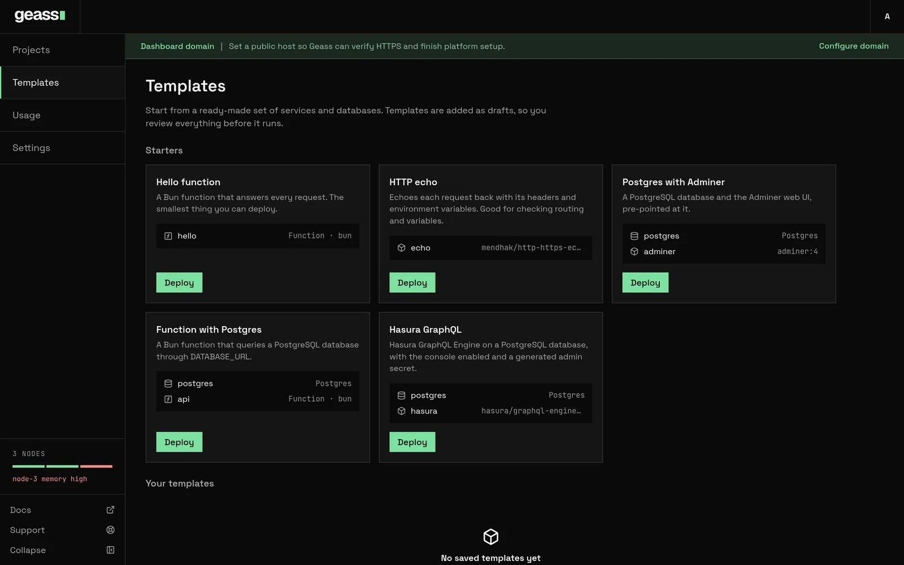

A **template** is a named set of services, functions and databases that Geass creates in a project in one step. Use one
to start a known stack, such as a database with a web UI, or to copy a stack you built so you can create it again in
another project. Templates do not run anything by themselves: they add **drafts** to your canvas, and you review them
and deploy.


*Screenshot with example data.*

A template is not a Helm chart. Geass has no Helm-based templates. A template is a list of Geass resources.

## Before you start

You need to be an admin. A read-only user sees "Your viewer role cannot browse templates." on the **Templates** page.

## The Templates page

Choose **Templates** in the left rail. The page has two groups:

- **Starters**: the templates that ship with Geass.
- **Your templates**: templates you saved from a project. It reads "No saved templates yet" until you save one.

Each card shows the template's name and description and a list of its resources, with the image, the database engine, or
`Function · bun`. A saved template also has a trash button. You can also reach the same list from a project: **From
template** above the canvas opens this page, and **+ Add resource** → **Template** lists the templates in the add box.
Choosing one there adds it to the current environment at once, without the **Project** and **Environment** choices.

## Built-in templates

| Template | What it creates |
| --- | --- |
| **Hello function** | One Bun function, `hello`, that answers every request. The smallest thing you can deploy. |
| **HTTP echo** | One service, `echo`, running `mendhak/http-https-echo:41` on port 8080. It echoes each request with its headers and environment variables. It sets `ECHO_INCLUDE_ENV_VARS=1`, `APP_NAME=geass-demo`, `APP_ENV=staging` and `FEATURE_FLAG=true`. |
| **Postgres with Adminer** | A Postgres database, `postgres`, and a service, `adminer`, running `adminer:4` on port 8080 with `ADMINER_DEFAULT_SERVER` set to the database's host. |
| **Function with Postgres** | A Postgres database and a Bun function, `api`, that queries it. `DATABASE_URL` is a reference to the database's connection string. |
| **Hasura GraphQL** | A Postgres database and a service, `hasura`, running `hasura/graphql-engine:v2.40.0` on port 8080. It gets `HASURA_GRAPHQL_DATABASE_URL` from the database, the console enabled, and a generated `HASURA_GRAPHQL_ADMIN_SECRET`. |

## Deploy a template

1. On the **Templates** page, choose **Deploy** on a card.
2. In **Deploy** *template name*, choose the **Project**. The list also has **New project**, which creates a project with a
   `production` environment first. If the project has more than one environment, choose the **Environment**.
3. Choose **Add to project**.

Geass opens the project and shows a toast: "*Template* added as drafts. Review them, then deploy." The new resources
are drafts with a **New** badge. Open them to check or change settings, then choose **Deploy changes** in the top bar.
See [Projects and environments](/docs/guides/projects-and-environments/#pending-changes-and-deploy-changes).

What Geass creates for each resource:

| Resource | Created as |
| --- | --- |
| A database | An in-cluster database of that engine, with the default size and volume (10 GiB for Postgres and MySQL, 1 GiB for SQLite) and backups turned on where the engine supports them. |
| A service | A draft with one replica, the default size (0.1 CPU, 128 MB) and the port from the template (8080 if it names none). No domain. |
| A function | The same as a service, with the template's runtime, code, mode and schedules. The schedules start when you deploy the function, like any other change. |
| A literal variable | A service variable with that value. |
| A generated secret | A service secret with a new random value, 32 hexadecimal characters. Each deploy of the template makes a new one. |
| A database reference | An environment variable that reads the new database's connection string or one part of it. |

Every resource gets a generated ID such as `calm-river`, and the template's name for it as its display name. If creating any
resource fails, Geass removes the ones it already created, so a failed deploy leaves nothing behind.

A few things to know after you deploy a template:

- A service that references a database starts once the database is ready. Until then its pods wait with
  `CreateContainerConfigError`, which is expected.
- Backups are on by default for new Postgres, MySQL and SQLite databases, but they protect nothing until the project has
  backup storage. See [Backups and restore](/docs/guides/backups-and-restore/). Turn them off in the database's
  settings if you do not want them.
- The dashboard never shows secret values, so it cannot show a generated secret. Read it with `kubectl`, or replace it
  with a value you choose by adding a secret of the same name on the service's **Variables** tab:

```bash title="Read the generated Hasura admin secret"
kubectl -n geass-system get secret <hasura service ID>-secrets \
  -o jsonpath='{.data.HASURA_GRAPHQL_ADMIN_SECRET}' | base64 -d
```

## Save your own template

Turn a project's environment into a template:

1. Open the project's **Settings** → **General**.
2. In **Generate Template from Project**, enter a **Template name** and optionally a **Description**. If the project has
   more than one environment, choose the **Environment**.
3. Choose **Generate template**. A **View in Templates** link appears.

Geass saves the **services, functions and in-cluster databases** of that environment. It keeps:

- for a service, its image, or its repository and branch, its port (when it is not 8080), and its variables: the plain
  variables (empty ones are dropped), references to databases in the same environment, and each secret as "generate a
  new secret";
- for a function, its runtime, code, mode (`http` or `event`), [schedules](/docs/guides/functions/#schedules) and variables;
- for a database, its engine and version.

It does not keep sizes, replicas, domains, sleep-when-idle settings, health checks, build settings, shared variables, backup
settings or volume sizes, and it never copies a secret's value. Resources it cannot include are listed under the form: "Not included: …"
(buckets, logical databases, and databases outside the cluster, such as AWS RDS or PlanetScale). An environment with
nothing to save is refused: "this environment has no services or in-cluster databases to save".

Delete a saved template with the trash button on its card and confirm in **Delete template?**. Projects that already used
it are not affected. Built-in templates cannot be deleted.

:::caution
A repository service in a template takes its GitHub link from the project you deploy the template into, at the moment you
deploy it. Link the project to GitHub first (see [GitHub and builds](/docs/guides/github-and-builds/)). A service created
before the link has none and cannot be built. A repository service also needs the registry described there.
:::

### Write a template by hand

A saved template is a ConfigMap in `geass-system`. You can write one yourself, for example to keep templates in version
control. The ConfigMap must be named `template-<id>`, carry the label `geass.dev/template: "true"`, and hold the
template in the key `template.json`:

```yaml title="template-acme-stack.yaml"
apiVersion: v1
kind: ConfigMap
metadata:
  name: template-acme-stack
  namespace: geass-system
  labels:
    geass.dev/template: "true"
data:
  template.json: |
    {
      "id": "acme-stack",
      "name": "Acme stack",
      "description": "The storefront with its database.",
      "resources": [
        { "key": "database", "kind": "database", "name": "postgres", "engine": "Postgres" },
        {
          "key": "web", "kind": "service", "name": "storefront",
          "image": "ghcr.io/acme/storefront:1.4.0", "port": 3000,
          "variables": [
            { "name": "DATABASE_URL", "from": { "resource": "database", "key": "uri" } },
            { "name": "SESSION_SECRET", "generate": "secret" },
            { "name": "LOG_LEVEL", "value": "info" }
          ]
        }
      ]
    }
```

```bash
kubectl apply -f template-acme-stack.yaml
kubectl -n geass-system get configmaps -l geass.dev/template=true
```

The template appears under **Your templates**. The rules Geass checks:

| Field | Rule |
| --- | --- |
| `id` | Lowercase letters, digits and dashes. The ConfigMap name must be `template-` plus the `id`. It cannot reuse a built-in ID. |
| `name`, `description` | `name` is required, up to 80 characters. `description` is up to 400. A resource's `name` is up to 63. |
| `resources` | 1 to 25. Each has a unique `key` of lowercase letters, digits and dashes, starting with a letter, up to 31 characters. |
| `kind` | `service`, `function` or `database`. |
| Service | Exactly one of `image` or `repository` (`owner/name`, with optional `branch`, default `main`). `port` 0 to 65535. |
| Function | `runtime` (`bun`, `node` or `python`) and `code`, within the [function limits](/docs/guides/functions/#limits). Optionally `mode` (`http`, the default, or `event`) and up to 8 `triggers`, each with a `name`, a `schedule` and optionally a `path` and a `payload`, under the rules in [Functions](/docs/guides/functions/#schedules). A service cannot have `runtime`, `code`, `mode` or `triggers`. |
| Database | `engine` of `Postgres`, `MySQL`, `Redis` or `SQLite`, and an optional `version`. A database has no `variables`. |
| `variables` | Up to 100 per resource, with names of letters, digits and underscores. Each has one of `value`, `generate` (only `"secret"`) or `from` (`resource` is a database `key` in the same template, `key` is one of `uri`, `host`, `port`, `username`, `password`, `database`). |
| Size | Geass refuses to save a template over 900 KB. A ConfigMap is itself limited to 1 MiB. |

A function resource looks like this. It goes in the `resources` list next to the others:

```json title="A function with a schedule, in template.json"
{
  "key": "report", "kind": "function", "name": "report",
  "runtime": "node", "mode": "event",
  "code": "export async function handler(event) { return { ok: true, trigger: event.trigger }; }",
  "triggers": [{ "name": "nightly", "schedule": "0 3 * * *" }]
}
```

A template that breaks a rule is not listed. Geass skips it and logs "Skipped invalid template".

## Through the API

All of these need a workspace admin token. See the [REST API](/docs/reference/rest-api/).

```bash title="List, deploy and delete"
curl -H "Authorization: Bearer $GEASS_TOKEN" https://geass.example.com/api/templates

curl -X POST https://geass.example.com/api/templates/postgres-adminer/deploy \
  -H "Authorization: Bearer $GEASS_TOKEN" -H "Accept: application/json" \
  -d project=proj-1a2b3c4d -d environment=staging

curl -X POST https://geass.example.com/api/templates/acme-stack/delete \
  -H "Authorization: Bearer $GEASS_TOKEN" -H "Accept: application/json"
```

Saving uses `POST /api/templates/create` with `project`, `environment`, `name` and `description`; the answer includes the
template and a `skipped` list.

## What happens under the hood

- Built-in templates are part of the operator binary. Saved templates are ConfigMaps named `template-<id>` in
  `geass-system`, labelled `geass.dev/template=true`, with the template in `template.json`. The ID of a saved template is
  the slug of its name plus four random characters.
- Deploying creates `GeassDatabase` objects first, then `GeassApp` objects, in `geass-system`, marked as drafts with the
  `geass.dev/deploy-workflow` annotation and a pending `created` change. A secret goes into `<service ID>-secrets`.
- A database reference becomes an `env` entry that reads a key of `<database ID>-connection`, the same as
  [Add reference](/docs/guides/environment-variables/#reference-a-database-or-bucket).

## Troubleshooting

**"project was not found" or "environment was not found in this project".** The project or environment in the request
does not exist. In the dialog, pick from the lists. Through the API, send the project's ID (`proj-…`), not its name.

**"template is not valid: …".** A hand-written template breaks a rule in the table above, or a function's schedule breaks a
[schedule rule](/docs/guides/functions/#schedules). The message names the resource and the field.

**My ConfigMap template is not listed.** Check the name is exactly `template-<id>` with the same `id` inside, the label is
set, and look for a "Skipped" line in `kubectl -n geass-system logs deploy/geass-controller-manager | grep -i template`.

**A service is stuck on `CreateContainerConfigError`.** It references the database's connection Secret, which exists
only once the database is deployed and ready. Deploy the database and wait.

**A repository service from a template will not build.** The project was not linked to GitHub when you deployed the
template, so the service has no GitHub connection. Delete it, link the project, and deploy the template again.

**Saving fails with "this environment has no services or in-cluster databases to save".** Buckets, logical databases and
external databases are not included, and the environment has nothing else.

**Saving fails with "this environment is too large to save as a template".** The template would be over 900 KB, usually
because of function code.

**The new database is marked "Not backed up" or "Needs storage".** The card says "Not backed up" and the database's
**Backups** tab says "Needs storage". Backups are on and the project has no backup storage. See
[Backups and restore](/docs/guides/backups-and-restore/).

## Related

- [Projects and environments](/docs/guides/projects-and-environments/)
- [Environment variables and secrets](/docs/guides/environment-variables/)
- [Functions](/docs/guides/functions/)
- [Databases](/docs/guides/databases/)
- [GitHub and builds](/docs/guides/github-and-builds/)
