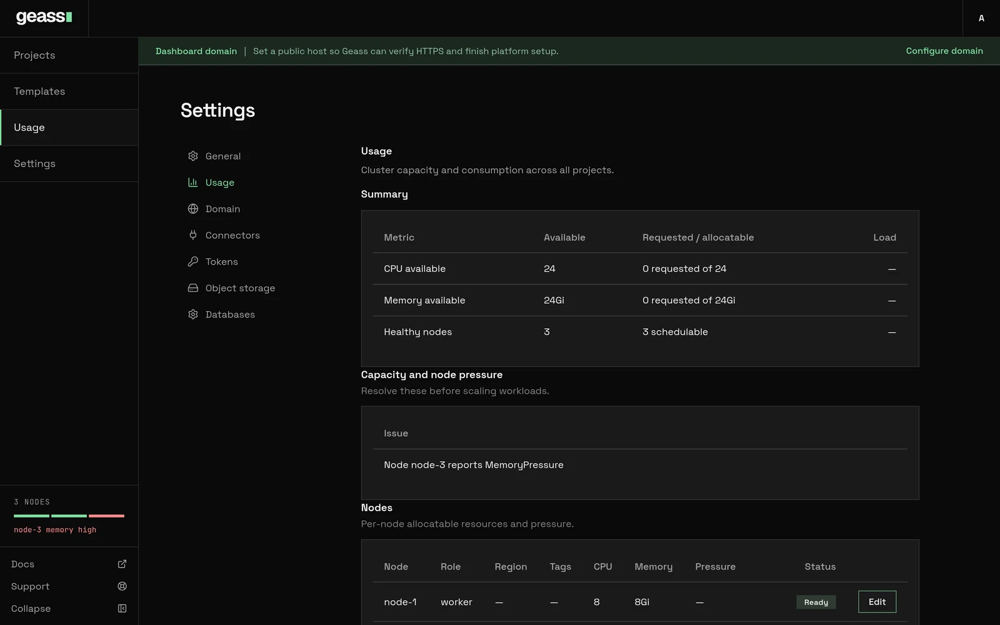

The **Usage** page answers two questions:

- How much of your servers is already reserved?
- Which servers need attention?

The page lists every server with its health. It adds up the CPU and memory that services reserve, by project and by region. Open the page before you create a large service or database. Also open it when a deploy fails because there is not enough room.


*Screenshot with example data.*

## Before you start

- Every signed-in user can read the page. Only admins see these controls:
  - **Edit** on a server. See [Scaling and placement](/docs/guides/scaling-and-placement/).
  - **Add server** above the **Nodes** table.
  - **Remove** on a server that was added with **Add server**.
- The page shows what services reserve, not what they use now. To see what they use, the monitoring add-on must be on. The installer turns it on. See [Logs, metrics and terminal](/docs/guides/observability/).

## Open the page

In the left rail, select **Usage**. You can also select **Settings**, and then **Usage**. The page has these sections, from top to bottom:

| Section | What it shows |
| --- | --- |
| **Summary** | The CPU and memory that are free, and the number of healthy servers. |
| **Capacity and node pressure** | One line for each server problem and each shortage. It appears only when there is a problem. |
| **Network isolation** | Whether the cluster enforces the isolation of projects. See [Network isolation](/docs/guides/network-isolation/#check-that-the-cluster-enforces-policies). |
| **Version** | The Geass release, and the K3s version that the servers run. |
| **Nodes** | One row for each server. **Add server** is above it. |
| **Usage by project** | What each project reserves, what it uses, and its share of the room. |
| **Cluster metrics** | Charts of what services use, and how busy the servers are. |
| **Geass health** | Charts of Geass itself. See [Metrics and alerts for the operator](/docs/guides/observability/#metrics-and-alerts-for-the-operator). |
| **Regions** | The default region for new projects. It appears after a server has a region. |
| **HA readiness** | Whether the cluster can run highly available databases. See [High availability](/docs/operations/high-availability/). |

## Reserved, can use up to, and using

Three numbers describe a service:

| Number | Meaning | Where Geass uses it |
| --- | --- | --- |
| **Reserved** | The CPU and memory that a service asks for. A copy starts only on a server that has this much free. | Every capacity number, and the [capacity check](/docs/guides/scaling-and-placement/#the-capacity-check) on deploy. |
| **Can use up to** | The most that a service can use. Above its CPU, the service is slowed. Above its memory, the service is stopped and restarted. | By default, it is the same as **Reserved**. You can set it higher on a service. See [Scale a service](/docs/guides/scaling-and-placement/#scale-a-service). |
| **Using** | What the service uses now. | The "using" numbers in **Usage by project**, and the charts. It needs the monitoring add-on. |

A server can look full on this page while its CPU is idle, because services reserved the room. Use the page to decide if something new fits. Use the charts to see if the servers work hard.

To stop one project from taking the whole cluster, set [project limits](/docs/guides/project-limits/).

:::note
These are the sizes that you can select in the dashboard:

- CPU: 0.1, 0.25, 0.5, 1, or 2.
- Memory: 128 MB, 256 MB, 512 MB, 1 GB, 2 GB, or 4 GB.

These are the default sizes:

- A service: 0.1 CPU and 128 MB.
- A Postgres, MySQL, or Redis server: 0.25 CPU and 512 MB for each instance. A highly available MySQL instance gets at least 1 GB.
- SQLite: 0.1 CPU and 128 MB.
- The object storage server with SeaweedFS: 0.25 CPU and 512 MB. SeaweedFS uses about 60 MB of memory when idle.
- The object storage server with Garage: 0.1 CPU and 256 MB. Garage uses about 6 MB when idle.
- The volume of the object storage server: 10 GiB. You can select the size when you set up the server, and make it larger later.
:::

## Summary

The **Summary** table has three rows:

| Row | **Available** | **Requested / allocatable** |
| --- | --- | --- |
| **CPU available** | The CPU of the servers minus what is reserved. | For example "450m requested of 2". |
| **Memory available** | The memory of the servers minus what is reserved. | For example "1Gi requested of 3880Mi". |
| **Healthy nodes** | The number of servers that are ready. | How many of them can take new work. |

The **Load** bar turns amber at 70 percent and red at 90 percent.

The totals count only servers that can take any work. They leave out these servers:

- A server that is not ready, or that is **Unschedulable**.
- A server that is reserved for a tag or a compliance tag. See [Scaling and placement](/docs/guides/scaling-and-placement/#reserved-tags).
- A server of a [pool](/docs/guides/node-pools/#what-runs-on-a-pools-nodes) with the **Ephemeral** badge. It takes services only.

The totals include Geass and its add-ons, because they also reserve room. A service that waits for a server also counts.

If no server reports its size yet, the page shows **Capacity unavailable** with "Schedulable nodes must report before totals appear."

## Version

| Row | Meaning |
| --- | --- |
| **Geass** | The Geass release, for example `v0.3.0`. A build that is not a release shows "development build". |
| **K3s (control plane)** | The K3s version of the control plane servers. |
| **K3s on workers (target)** | Appears only during an upgrade of the workers. It shows the target version, the server that Geass upgrades now, and how many are left. |

You cannot update Geass from this page. To update, run the installer of a newer release on the control plane. See [Upgrade Geass](/docs/operations/upgrading/).

## Nodes

Each row of the **Nodes** table is one server:

| Column | Meaning |
| --- | --- |
| **Node** | The name of the server. |
| **Role** | `control-plane` or `worker`. |
| **Pool** | The [pool](/docs/guides/node-pools/) of the server, as a link. An **Ephemeral** badge means that the server keeps no data. Databases, buckets, and volumes never run on it, and Geass can remove it when the load drops. A dash means no pool. |
| **K3s** | The K3s version that the server runs. |
| **Region** | The region, and the site after a dot, for example `eu · hetzner-fsn1`. |
| **Tags** | The tags of the server. "(reserved)" means that the tag keeps other work off the server. "(compliance)" means that the server is only for projects that require the tag. See [Compliance node tags](/docs/guides/compliance-tags/). |
| **CPU**, **Memory** | What the server offers to services. This is less than the full machine. |
| **Pressure** | The problems that the server reports. A dash means none. |
| **Status** | **Ready**, **Not ready**, or **Cordoned**. A server that has not joined yet has no node, but it has a row. Its status is **Waiting**, **Creating machine**, **Joining**, or **Failed**, and the error is under the status. |
| Menu | The actions for the server. See [Work with a server](#work-with-a-server). |

**Cordoned** means that the server takes no new work. The services on it continue to run. The **Pressure** column and the
rail call this state **Unschedulable**. These are the causes:

- You cordoned the server. See [Cordon a server](#cordon-a-server).
- Geass upgrades K3s on the server. The **Version** section shows the upgrade.
- Geass empties a server of an autoscaling pool before it removes the server.
- Geass removes the server.

Under **Cordoned**, the row says "Cordoned by Geass" when Geass did it. Geass cordons a server to upgrade it or to empty
it, and it uncordons the server itself.

### Add or remove a server

To add a server, click **Add server**. The server can be a new machine at a cloud, or a machine that you have. See [Add servers](/docs/getting-started/add-servers/#add-a-server-from-the-dashboard-or-the-command-line).

To remove a server that was added with **Add server**, do these steps:

1. Open the menu of the server, and select **Remove**.
2. Enter the name of the server.
3. Click **Remove server**.

Geass moves the services of the server to other servers. For a machine that Geass created, Geass then deletes the machine. The control plane and the servers of a pool have no **Remove**. To remove a server of a pool, change the pool.

### Work with a server

The menu at the end of a row has the actions that apply to the server. **Retry** is a button in the row of a server that failed.

| Action | What it does |
| --- | --- |
| **Edit** | Sets the region, the site, and the tags of the server. See [Set a server's region, site, and tags](/docs/getting-started/add-servers/#set-a-servers-region-site-and-tags). |
| **Cordon**, **Uncordon** | Stops new work on the server, or allows it again. See [Cordon a server](#cordon-a-server). |
| **Retry** | Starts a server that failed to join over. See [Fix a server that did not join](/docs/getting-started/add-servers/#fix-a-server-that-did-not-join). |
| **Update host keys** | Replaces the host keys that Geass accepts from a server that you have. See [Update the host keys of a server](/docs/getting-started/add-servers/#update-the-host-keys-of-a-server). |
| **Remove** | Removes a server that you added. |

Only admins see the menu.

### Cordon a server

To keep new work off a server, cordon it. The services on the server continue to run. A server that restarts a service
does not receive it. Cordon a server before you work on the machine.

1. Open the menu of the server, and select **Cordon**.
2. To allow new work again, open the menu, and select **Uncordon**.

From a terminal, run `geass nodes cordon NODE`, and `geass nodes uncordon NODE`. `NODE` is the name in the **Node** column.

These rules apply:

- Geass refuses to cordon the last server that can start new work. Add a server first.
- A cordoned server does not count for [high availability](/docs/operations/high-availability/#check-readiness). The
  **Healthy nodes** count drops by one.
- A pool never removes a server that you cordoned.
- Geass refuses **Uncordon** for a server that Geass cordoned, because Geass uncordons it when it finishes.

## Server health in the rail

The bottom of the left rail shows the health of your servers. It is hidden when you collapse the rail.

- The label shows the count, for example "3 NODES".
- One bar shows each server: green for healthy, red for down or under pressure, and amber for **Unschedulable**.
- A line under the bars names the worst problem, for example `node-3 memory high`, or "all healthy".
- To open the **Usage** page, select the bars.

## What each problem means and what to do

The same problems show in the **Pressure** and **Status** columns, and in **Capacity and node pressure**.

| In the rail | On the page | What it means | What to do |
| --- | --- | --- | --- |
| `not ready` | **Not ready** | The server stopped answering. The machine might be off, or K3s might have stopped. | Check that the machine is on. After five minutes, Geass sets up a worker again over SSH. See [Troubleshooting](/docs/operations/troubleshooting/). |
| `memory high` | `MemoryPressure` | The server has almost no free memory. The server starts to stop services. | In **Usage by project**, find the largest reservations. Lower copies or memory, or add a server. |
| `disk full` | `DiskPressure` | The disk of the server is almost full. New services cannot start. | Delete the services, databases, and volumes that you do not need, or add a server. To clean the disk of the server itself, see [Under the hood](#under-the-hood). |
| `too many processes` | `PIDPressure` | A service starts too many processes. | Find the service, and restart or remove it. |
| `network down` | `NetworkUnavailable` | The network of the server is not set up. | In a cluster at more than one provider, check the firewall. See [Nodes at more than one provider](/docs/operations/multi-provider/). Otherwise, see [Under the hood](#under-the-hood). |
| `unschedulable` | **Unschedulable** | The server takes no new work. | See the causes in [Nodes](#nodes). |
| `under pressure` | Another problem | The server reports another problem. | Read the **Pressure** column. |

When several servers have problems, the rail names a down server first. Then it names a server under pressure, and then an **Unschedulable** server.

## Capacity and node pressure

This section lists problems to fix before you add more work:

- One line for each server problem, for example "Node node-3 reports DiskPressure".
- "Available CPU is too low for a new service. Scale up the cluster before creating in-cluster resources" when less than 0.1 CPU is free.
- "Available memory is too low for a new service. Scale up the cluster before creating in-cluster resources" when less than 128 MB is free.
- "Services may use up to … of memory between them and the servers have …. If they all do at once, those using more than they reserved restart first". This line is a warning only. It appears when the **can use up to** values of all services add up to more than the servers have. See [Scale](/docs/guides/apps/#scale).

To fix a shortage, make room free or add a server. See [Add servers](/docs/getting-started/add-servers/), or let a [node pool](/docs/guides/node-pools/) add servers. Geass refuses a new service that does not fit. See [The capacity check](/docs/guides/scaling-and-placement/#the-capacity-check).

## Usage by project

**Usage by project** starts with a sentence, for example "The cluster has 4.00 vCPU and 7.5 GB of memory across 3 nodes." A table follows, with the largest project first:

| Column | Meaning |
| --- | --- |
| **Project** | The name of the project. |
| **Region** | The region of the project, or the default region. A dash means any server. |
| **Services running** | The copies of services and databases that run, in every environment of the project. |
| **CPU**, **Memory**, **Storage** | What the project reserves. With monitoring, a cell shows "using of reserved", for example "0.05 vCPU of 0.25 vCPU". Storage is the size of the volumes of the project. |
| **Share of its capacity** | The larger of the CPU share and the memory share, as a bar. The capacity is that of the region of the project, or of all servers. |

The last row, **Geass and system services**, is everything that is not a project. It includes Geass, its add-ons, and the shared database servers.

When servers have regions, **By region** follows. It shows the servers of each region, and how much of their CPU and memory is reserved.

The **Usage** section in the **Settings** of a project shows the same table for that project, with its charts.

## Cluster metrics

**Cluster metrics** charts the CPU and memory that services use, how busy the servers are, and the network traffic. Select the period in the **Time range** menu. See [Logs, metrics and terminal](/docs/guides/observability/).

## From the command line

```bash
geass nodes list
```

A script can read the same data at `GET /api/usage` with an API token. See [Users and tokens](/docs/guides/users-and-tokens/) and the [REST API](/docs/reference/rest-api/).

## Usage by organization, for billing

More than one [organization](/docs/guides/organizations-and-workspaces/) can share a cluster. Geass can record what each organization reserved, hour by hour, so that the platform can bill it. This meter is off by default. Only platform administrators can read it. Geass has no dashboard option or command to turn on the meter yet. See
[Under the hood](#under-the-hood).

### What is metered

Every minute, Geass adds what is reserved to the current hour:

| Figure | What it is | Unit |
| --- | --- | --- |
| CPU | What the services and databases reserve, from the time they start until they stop. | Core-hours |
| Memory | The same, for memory. | GiB-hours |
| Storage | The size of each volume. | GiB-hours |
| Egress | Not metered. Always `null`. | |

A service belongs to an organization through its project. Builds of an organization belong to it, under the workspace `""`. That workspace also holds the projects that are in no workspace. Geass keeps two more totals:

- **unassigned**: the projects that belong to no organization.
- **platform**: everything that belongs to no project. That is Geass, its add-ons, and the shared database and bucket servers.

The meter does not measure these items:

- **What is used.** An idle service that reserves 0.25 CPU is billed 0.25 CPU. A service that reserves nothing is billed nothing. With [noisy-neighbour limits](/docs/guides/tenant-limits/#how-a-containers-defaults-are-worked-out), such a service gets a default reservation, and that reservation is billed.
- **Traffic.** Geass has no number for traffic that leaves the cluster.
- **Shared servers by organization.** A database on a shared server, and the bytes in buckets, count under **platform**.
- **Servers.** If you bill an organization for its own servers, bill them from their pool.

### How it is kept

Geass keeps each hour (UTC) for 62 days. An hour is **closed** when it is metered to its end, or five minutes after its end. After that, the hour never changes. If Geass was off for a time, the hour shows less than 3600 `meteredSeconds`.

When you turn off the meter, Geass keeps the stored hours. When you turn it on again, Geass deletes the hours older than 62 days. Geass has no dashboard option to delete every hour. See [Under the hood](#under-the-hood).

### Read it

`GET /api/v1/usage/hours` returns every hour from `from` to `to`, in RFC 3339. Add `?org=` for one organization. The default is the last 24 hours, and the maximum is 31 days. The request needs a platform administrator or an install-wide admin token.

```bash title="What each organization reserved this morning"
curl -fsS -H "Authorization: Bearer $GEASS_TOKEN" \
  "https://geass.example.com/api/v1/usage/hours?from=2026-10-23T09:00:00Z&to=2026-10-23T12:00:00Z" \
  | jq -r '.hours[] | .start as $hour | .orgs[] | [$hour, .org, .workspace, .cpuCoreHours, .memoryGiBHours, .storageGiBHours] | @tsv'
```

To bill as you go, do these steps:

1. About every hour, ask from the `next` value of the last answer.
2. Store each hour by its start, organization, and workspace. Replace what you stored for that hour before.

An open hour (`"closed": false`) comes again in the next answer, until it closes. See the [REST API](/docs/reference/rest-api/#usage-by-organization).

## Troubleshooting

**The page says "Capacity unavailable".**
No server is ready to take work yet. If your only server is not ready, **Unschedulable**, or reserved, the cluster has no room for general work.

**"Healthy nodes" shows 3, but fewer can take work.**
A server that is **Unschedulable** or reserved for a tag cannot take general work. To remove a reservation, click **Edit** on the server.

**The "using" numbers are missing.**
The numbers need the monitoring add-on. Without it, the table says "Live use appears once monitoring is installed."

**The cluster looks full, but nothing runs.**
Services that wait for a server still reserve room. Look for services that stay in **Setting up**.

**A server is red in the rail, but the page shows Ready.**
The bar is also red when the server is under pressure. Read the line under the bars, or the **Pressure** column.

**The charts say "Metrics are not available yet".**
See [Logs, metrics and terminal](/docs/guides/observability/#troubleshooting).

## Under the hood

The page reads the cluster live, and Geass stores nothing. The "using" numbers come from Prometheus. To compare the page with the cluster, run these commands:

```bash
kubectl get nodes -o wide
kubectl describe node <node>        # Conditions, Allocatable, and Allocated resources
kubectl top node                    # live use
kubectl top pod -A --sort-by=memory
kubectl get pods -A --field-selector=status.phase=Pending
```

**Cordon** and **Uncordon** set `spec.unschedulable` on the Kubernetes node. These commands do the same:

```bash
kubectl cordon <node>
kubectl uncordon <node>
```

To check K3s on a server that is not ready, run `systemctl status k3s` on a control plane server, or `systemctl status k3s-agent` on a worker. For `NetworkUnavailable`, restart K3s on the server with `sudo systemctl restart k3s`, or `sudo systemctl restart k3s-agent` on a worker. For `PIDPressure`, `kubectl top pod` finds the service with the most processes.

For `DiskPressure`, free space on the server itself: unused container images (`sudo k3s crictl rmi --prune`), old logs, or large files.

To turn on the meter of usage by organization, run this command on the control plane server:

```bash
sudo k3s kubectl -n geass-system patch geassplatformconfig platform --type merge -p '{"spec":{"usage":{"enabled":true}}}'
```

To delete every stored hour of the meter, run this command:

```bash
sudo k3s kubectl -n geass-system delete configmap -l geass.dev/usage-hour
```

## Related

- [Scaling and placement](/docs/guides/scaling-and-placement/)
- [Node pools and autoscaling](/docs/guides/node-pools/)
- [Project limits](/docs/guides/project-limits/)
- [Cluster size](/docs/operations/sizing/)
- [Logs, metrics and terminal](/docs/guides/observability/)
- [High availability](/docs/operations/high-availability/)
- [Troubleshooting](/docs/operations/troubleshooting/)
