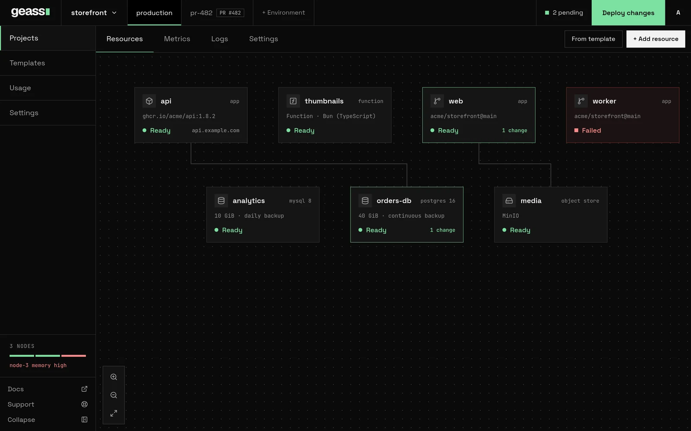

This page defines the words that the dashboard and the rest of these docs use, and how they fit together. Read this
page one time, then use the links to learn more. For the mechanisms behind the words, see
[How Geass works](/docs/overview/how-it-works/).


*Screenshot with example data.*

## The shape of it

```text
cluster (your servers, one control plane + workers)
 |-- platform settings (domain, connectors, tokens, object storage, shared databases)
 |-- nodes (with optional region, site, tags), singly or in pools
 `-- projects
      `-- environments (production, staging ...)
           `-- resources: services, functions, databases, logical databases, buckets
```

## Cluster

The cluster is the set of servers that Geass manages. The installer creates the cluster from one server, the control
plane. You can join more servers as workers. In Kubernetes, the cluster is a `GeassCluster` named `default`. It reports
`Ready` when its add-ons are running. See [Install Geass](/docs/getting-started/install/).

## Projects

A project groups the services, databases, and buckets of one product, client, or team. A project has an ID, for
example `proj-1a2b3c4d`, and a display name, for example `morning-beach`. Geass generates both when you click
**New project**. You can rename the project under **Settings → General** of the project. The ID never changes.

A project has settings that apply to all its environments:

- Its region.
- The node tags that it requires.
- Its GitHub link.
- Webhooks.
- Backup storage.
- Network access.
- Its API tokens.

By default, projects are private to each other. See [Projects and environments](/docs/guides/projects-and-environments/).

## Environments

An environment is an isolated copy of the resources of a project, for example `production` or `staging`. Every
project starts with `production`. Each environment has its own:

- Kubernetes namespace, `<project-id>-<environment>`.
- Resources.
- List of pending changes.
- Shared variables.

A resource belongs to exactly one environment. Thus, the same service in two environments is two services. The
environment tabs at the top of a project switch between environments.

To add an environment, do these steps:

1. Click **+ Environment**. The **Settings** of the project open.
2. Select **Environments**.
3. Click **New Environment**.

Pull request environments are temporary copies that Geass makes for each pull request. See
[Pull request environments](/docs/guides/pull-request-environments/).

## Resources

A resource is anything that you deploy into an environment. The dashboard and the Kubernetes objects use different
names for resources:

| In the dashboard | What it is | Kubernetes kind | Guide |
| --- | --- | --- | --- |
| Service | A container that runs from a Docker image, or from a GitHub repository that Geass builds | `GeassApp` | [Apps](/docs/guides/apps/) |
| Function | A service whose source is one file of Bun (TypeScript), Node.js, or Python code. It is a server or an event handler, and it can run on schedules | `GeassApp` with a function source | [Functions](/docs/guides/functions/) |
| Database | PostgreSQL, MySQL, Redis, or SQLite in the cluster, or a record of an external database, for example AWS RDS or PlanetScale | `GeassDatabase` | [Databases](/docs/guides/databases/) |
| Logical database | A separate database, with its own login, on a database server that already runs | `GeassLogicalDatabase` | [Shared database servers](/docs/guides/shared-database-servers/) |
| Bucket | S3-style storage, on the object storage server of the cluster (SeaweedFS or Garage) or in AWS S3 | `GeassObjectStore` | [Object storage](/docs/guides/object-storage/) |

To add a resource, click **+ Add resource**, or use **Templates**. A template is a ready-made set of resources that
Geass adds as drafts. See [Templates](/docs/guides/templates/).

Every resource has an **ID** and a **display name**. Geass generates the ID when you create the resource, and the ID
never changes. You can edit the display name. You type the ID to confirm a deletion. The ID is also what shows in
Kubernetes names.

The [Resources overview](/docs/reference/resources/overview/) describes the resource kinds.

### Event functions and schedules

A function runs in one of two modes:

- In **server** mode (`http`, the default), your code is a program that listens on the port in `PORT`.
- In **handler** mode (`event`), your code only exports a `handler(event)` that returns the response. Geass serves
  HTTP for it.

To change the mode, use the list on the **Code** tab of the function. It switches between **Server (serves HTTP)** and
**Handler (gets an event)**. On the command line, set the mode with `geass apps create --mode`.

A **schedule** calls a function on a cron expression in UTC. The API calls a schedule a trigger. Each run is an HTTP
`POST` to the function. If the function is asleep, Geass wakes it first. A function can have a maximum of 8 schedules.
The schedules start with the next deploy. Geass runs them as Kubernetes `CronJob` objects in the namespace of the
project. See [Functions](/docs/guides/functions/) and
[Command line](/docs/guides/command-line/#functions-and-schedules).

## Drafts, pending changes and Deploy changes

This is the first workflow that you use.

- A new resource is a **draft**. It exists in Geass, and nothing runs.
- Geass holds changes to a resource as **pending**. The changes are saved, but the running resource does not change.
  The top bar shows `N pending`, and its list names what changed in each resource. N counts saved changes, not
  resources. A new draft counts as one, and each variable that you save adds one more.
- **Deploy changes** applies all pending changes in the current environment together. After the deploy, the top bar
  reads **Up to date**.
- Some settings are **live**: a replica count, autoscaling, sleep when idle, a domain, HTTPS, and metrics. They apply
  immediately when you save them, because they do not replace the running container. The settings page marks them
  **Applies instantly**. The dashboard says `Saved and applied`, or `Saved` when the change waits for a deploy.

A resource that fails to deploy shows **Failed** and waits for **Retry**. For a full example, see
[Deploy your first app](/docs/getting-started/first-app/). Also see
[Projects and environments](/docs/guides/projects-and-environments/#pending-changes-and-deploy-changes).

## Sleep when idle

You can set a service to **Sleep when idle**. When the service has had no requests for a time that you select, Geass
stops it. In the dashboard, the time is 1 to 1440 minutes, and the default is 5. The next request to its public host
starts the service again. The request waits while the service starts. A sleeping service reserves no CPU or memory.

Sleep when idle has these conditions:

- It needs the serverless add-on (KEDA and its HTTP add-on). The add-on is off until you turn it on for the cluster.
- It needs a public host.
- A service cannot use it together with CPU autoscaling.

In Kubernetes, the setting is `spec.scaleToZero` on the `GeassApp`. See [Sleep when idle](/docs/guides/scale-to-zero/).

## Nodes

A node is one server in the cluster. The first node is the **control plane**. It runs the K3s server, the operator, and
the dashboard. The other nodes are **workers**, which join over SSH with a `GeassNode` object. A worker is a server
that you have, or a machine that Geass creates at a cloud.

Geass shows nodes in the **Nodes** table on the **Usage** page, in the left rail. The table shows the role of each node,
its pool, region, tags, CPU, memory, pressure, and status (**Ready**, **Not ready**, or **Unschedulable**). See
[Add servers](/docs/getting-started/add-servers/).

## Node pools

A **pool** (`GeassNodePool`) is a group of nodes that Geass adds and removes for you. A pool makes machines at a cloud,
or joins servers that you listed. A pool has a maximum number of nodes, which is the limit on what it can cost.

- A pool that does not autoscale keeps a fixed number of nodes.
- An autoscaling pool adds nodes when pods cannot start because there is not enough room. It empties idle nodes and
  then removes them.

By default, the nodes of a pool are **ephemeral**. They run services, and never databases, buckets, or volumes. Thus,
any of them can go at any time.

Pools need a **connection for machines**. That connection holds the credentials that Geass uses to create and delete
servers at a cloud. It belongs to the cluster, and only an admin can use it. Pools are experimental. See
[Node pools and autoscaling](/docs/guides/node-pools/) and
[Cloud connections for machines](/docs/guides/connectors/clouds/).

## Regions, sites and tags

You can label nodes to control where workloads run:

- A **region** groups nodes that are close together, for example `eu` or `us`. A project with a region runs only on
  nodes in that region. You can select the region of a project when you create it. You can change the region under
  **Settings → General** of the project. You cannot change the region while the project has an in-cluster database,
  because the data is on those nodes. The **Usage** page also holds a default region for projects that do not select a
  region.
- A **site** is the provider or location in a region, for example `hetzner-fsn1`. Kubernetes calls it the zone.
- A **tag** says what a node is for, for example `storage` or `gpu`. A tag can be **reserved**. A reserved tag keeps
  off the node every workload that does not ask for the tag.
- A **compliance tag** is a reserved tag that a project can **require**, for example `hipaa`. To use it, do these steps:
  1. Mark the tag on the nodes that qualify. On the **Usage** page, click **Edit** on a node.
  2. Select the tag under **Settings → Compliance** of the project.

  After that, everything that the project runs stays on nodes that have the tag. This includes its databases, buckets,
  builds, and backup jobs. Those nodes take no work from other projects. A compliance tag controls where Geass puts
  work. It does not move data that is already in a different location, and it does not protect a compromised node.

See [Scaling and placement](/docs/guides/scaling-and-placement/) and
[Compliance node tags](/docs/guides/compliance-tags/).

## Connections and connectors

Geass can use accounts that you already have. **Settings → Connectors** has three parts:

- **Code and domains** (GitHub and Cloudflare).
- **Server clouds**.
- **Storage and databases** (AWS and PlanetScale).

| Connector | Used for | Scope |
| --- | --- | --- |
| GitHub | Deploying repositories, push-to-deploy, pull request environments, and builds and deploys reported back to GitHub. A GitHub App that Geass registers | The whole platform, then linked to each project |
| Cloudflare | DNS records, and an optional tunnel for the dashboard and services | The whole platform |
| AWS | S3 buckets, database backups | One project: each connection is saved for a single project |
| PlanetScale | PlanetScale databases | One project |

AWS and PlanetScale credentials are **cloud connections** (`GeassCloudConnection`). Each cloud connection is scoped to
a single project, and only that project can use it.

A cloud connection can also be for creating machines (its purpose is `Compute`). Such a connection belongs to the
cluster, never to a project, and only an admin can use it. Geass can create machines at Amazon EC2, Azure,
DigitalOcean, Google Cloud, Hetzner, Linode, Oracle Cloud, OVHcloud, Scaleway, UpCloud, and Vultr. Through a webhook,
it can create machines at any other provider. Creating machines is experimental.

Geass stores the credentials as Kubernetes Secrets in the cluster. See [Cloud connectors](/docs/guides/connectors/).

## Platform settings

**Settings** in the left rail holds the settings that apply to the whole platform:

| Page | What is on it |
| --- | --- |
| **General** | A summary: clusters, dashboard URL, healthy nodes, and links to the other pages |
| **Usage** | Cluster capacity, the nodes and their placement, usage for each project, cluster metrics, the health of the operator itself (**Geass health**), the default region, and high availability readiness. See [Usage and capacity](/docs/guides/usage-and-capacity/) |
| **Domain** | The public address of the dashboard. See [Connect a domain](/docs/getting-started/connect-domain/) |
| **Connectors** | The four connectors above |
| **Tokens** | Workspace API tokens |
| **Object storage** | The object storage server of the cluster, SeaweedFS or Garage, that holds in-cluster buckets. Select it one time, set its CPU, memory, and volume size, and make the volume bigger later |
| **Databases** | Shared database servers |

## Roles and tokens

People sign in to the dashboard with one of two roles:

- An **admin** can change everything.
- A **viewer** can only read. The dashboard does not show sensitive values to a viewer.

A Kubernetes Secret defines the users.

Scripts, CI, the command line, and AI agents use **API tokens**. A *workspace token* acts across the platform with one
of three roles. The dashboard calls the role of a token its **Access**:

| Access | Role | What it can do |
| --- | --- | --- |
| **Full access** | `admin` | Everything that the dashboard can do |
| **Read only, with logs** | `observer` | Read everything that a viewer can read, and also logs and the names of variables. It changes nothing. It is the role for a monitoring script or an agent that only watches. It is a token role only: a dashboard user cannot be an observer |
| **Read only** | `viewer` | Read resources, without sensitive values |

A *project token* can deploy, scale, roll back, edit variables, and read logs in one environment of one project, and
nothing else.

`geass login` does not ask for a password. It shows a code. A signed-in admin approves the code in the dashboard, on
the page **Sign in the command line** at `/device`. The admin also selects the access and an expiry. Geass then gives
the command line a workspace token one time. See [Sign in to the dashboard](/docs/getting-started/sign-in/),
[Command line](/docs/guides/command-line/), and [Users and API tokens](/docs/guides/users-and-tokens/).

## Other terms you will meet

- **Add-on:** a platform component that Geass installs for you. The add-ons are cert-manager, metrics, Longhorn
  storage, and log collection. Geass installs the serverless add-on for sleep when idle only when you turn it on.
- **Command line:** `geass`, a program for your own machine. It deploys and runs services through the `/api/v1` API of
  the dashboard. `geass mcp` is the same program as an MCP server for AI agents. See
  [Command line](/docs/guides/command-line/) and [MCP server for AI agents](/docs/guides/mcp-server/).
- **Capacity gate:** the check that refuses a deploy when the cluster does not have the CPU and memory that the deploy
  asks for. If an autoscaling pool can make room, the check lets the deploy in. See
  [Usage and capacity](/docs/guides/usage-and-capacity/).
- **Ephemeral node:** a node, usually of a pool, that keeps no data. Services run there. Databases and volumes never
  do. See [Node pools](/docs/guides/node-pools/#what-runs-on-a-pools-nodes).
- **Orphan machine:** a machine at a cloud that has the labels of a pool and belongs to no node. It might still cost you
  money. See [Node pools](/docs/guides/node-pools/#machines-no-node-owns).
- **Backup:** a copy of a database in a bucket in your AWS account. See
  [Backups and restore](/docs/guides/backups-and-restore/).
- **Network isolation:** each project is private to other projects unless you allow them. See
  [Network isolation](/docs/guides/network-isolation/).

The [Glossary](/docs/reference/glossary/) lists every term with a link.

## Related

- [What is Geass](/docs/overview/introduction/)
- [How Geass works](/docs/overview/how-it-works/)
- [Deploy your first app](/docs/getting-started/first-app/)
- [Node pools and autoscaling](/docs/guides/node-pools/)
- [Users and API tokens](/docs/guides/users-and-tokens/)
- [Glossary](/docs/reference/glossary/)
